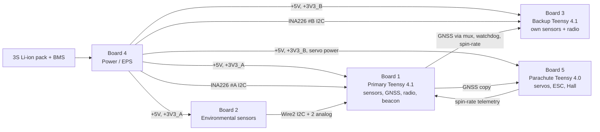

# Team VRITRA — CAN-7USAT 2026: all flight PCBs
## KiCad 10 step-by-step guide — revision 6.3 (Boards 1–5)

Revision 6.3 replaces the powered-resistance mux test with a safe voltage-mode test (C.5), gives the mux footprint from 7Semi's STEP model (bottom row 25.99 mm below pad 1), and adds carrier CS pull-ups and a TPL5010 bypass capacitor. Revision 6.2 corrected the UART-mux select wiring (A → MUX_SEL, B → GND, C.5). Revision 6.1 added a one-line-per-pin table of all 48 Teensy 4.1 contacts (B.4.3) and the full Teensy pin-count explanation (B.4.4, B.5.3). Revision 6 supersedes revision 5. It keeps every correction made in revision 5 and adds Boards 2, 3, 4 and 5, the final component allocation, the Teensy 4.0 parachute controller, and a pin audit against PJRC's own pinout cards.

**How to read the status marks used in the tables**

| Mark | Meaning |
|---|---|
| **SRC** | Checked against the manufacturer's own page/datasheet (listed in the source register, last section). |
| **PHOTO** | Taken from the photographs you supplied. Match it against the physical module before fabrication. |
| **VERIFY** | Vendor did not publish enough to confirm. Read the label printed on your board, or measure, and fill it in before drawing that footprint. |

KiCad 10 was not run in the preparation environment. Menu paths follow the official KiCad 10.0 manuals. Nothing in this guide replaces running ERC/DRC on your real project and a physical 1:1 fit check.

---

## PART 0 — Project context (read this first if you are new to the project)

This section explains **what we are building, why it is built this way, and how the rest of this document is organised**, so that any team member, mentor or reviewer can pick up the work without having been in earlier discussions.

### 0.1 The mission in one paragraph

Team VRITRA (Lovely Professional University, Team ID **2026-INSPACe-CAN-7USAT-025**) is building a CanSat for the **IN-SPACe CAN-7USAT India Student Competition 2026**. The CanSat is carried by a rocket to about 1000 m, ejected, and descends first under a drag parachute, then under a GPS-steered ram-air parafoil that opens at 600 m. A mechanical gyroscopic wheel stabilises it. During the whole flight it transmits telemetry over LoRa to our ground station, and it logs extra environmental data (CO₂, ozone, particulates, UV, spectral light, lightning, humidity) for recovery after landing.

### 0.2 Competition rules that shape the electronics

These come from the competition's *Mission Requirement & Competition Guidelines* and the *Team Frequency Assignments* sheet supplied to teams.

| Rule | What it forces on the PCBs |
|---|---|
| Total mass under 1.0 kg (±0.050 kg); must fit a Ø0.15 m × 0.40 m cylinder | Round Ø110 mm boards, few connectors, breakout modules instead of heavy enclosures |
| Survive 15 g launch and 30 g shock; circuit boards hard-mounted | Boards are structural plates on rods; all modules soldered, not in loose sockets |
| Telemetry at ≥1 Hz, ASCII comma-separated, 16 mandatory fields | Every mandatory field needs a sensor on a telemetry Teensy (0.4 below) |
| Data also saved onboard (SD card) in case of telemetry loss | Teensy 4.1 microSD + W25Q64 flash |
| Ground station commands telemetry ON/OFF; each link switchable by telecommand | Radio controlled by firmware; no hard-wired transmitter |
| Auto transmit-off 90 min after launch detection | Firmware timer |
| Audio beacon ≥ 92 dB | MAX98357A amplifier + SM400204-1 speaker |
| External power switch with indicator light/sound; 2 h pad wait | Board 4 switch + LED; battery sizing |
| No LiPo; lithium cells must be metal-cased (18650-type) | Molicel 21700 Li-ion pack |
| Descent: primary parachute <20 m/s; secondary mechanism at 600 m ±10 m to 1–3 m/s | Parachute controller (Board 5) with its own barometer |
| Mechanical gyroscopic stabilisation; its spin rate is telemetry field 14 | Hall sensor on the wheel, read by Board 5 |
| Radio: **868 link main 867.00 MHz, backup 865.75 MHz, LoRa, BW 125 kHz, SF10, CR 4/5, sync word 0x98** (team 025's row) | Core1121 (LR1121) radios; settings live in firmware |
| Never transmit in reserved bands (433 MHz ignition, 446 MHz voice, 915 MHz ignition, the 2.4 GHz XBee channels); video transmitters must be jury-approved | XIAO ESP32-S3 camera modules must have Wi-Fi and Bluetooth disabled in firmware |

### 0.3 How the hardware is organised

The CanSat interior is a stack of **five round PCBs (Ø110 mm)** threaded on **four fibreglass rods (Ø8 mm)**, about 40–50 mm apart. Each PCB *is* the structural plate: the rod holes are drilled by the PCB fabricator, not afterwards.

Every sensor, radio and processor we bought is a small **pre-made breakout module**. Our PCBs are **carrier boards**: they hold those modules by their pin headers and connect them with copper traces. That is why most "footprints" in this guide are rows of holes matching a module's header, not the pads of a bare chip.



| Board | What it does | Why it is a separate board |
|---|---|---|
| 1 Primary | Flight computer: all live telemetry, GNSS, LoRa, logging, beacon | Main chain; everything flight-critical in one place |
| 2 Environmental | Bonus-payload sensors | Keeps heated/slow gas sensors and their long I²C cable away from the flight bus; noise and thermal isolation |
| 3 Backup | Takes over telemetry if the primary fails | A fault on Board 1 cannot destroy the backup |
| 4 Power | Battery input, switch, regulators, current/voltage monitors | Switching regulators kept away from sensors and RF |
| 5 Parachute | Deploys and steers the parafoil, runs the gyro wheel | Deployment must never depend on the telemetry boards surviving |

### 0.4 Where each mandatory telemetry field comes from

| # | Field (competition) | Primary source (Board 1) | Backup source (Board 3) |
|---|---|---|---|
| 1 | Team ID | Firmware constant | Firmware constant |
| 2 | Time since power-up (s) | Teensy clock, DS3231 RTC | Teensy clock |
| 3 | Packet count | Firmware | Firmware |
| 4 | Altitude, relative to ground (0.1 m) | BMP585 #1 | BMP585 #2 |
| 5 | Pressure (1 Pa) | BMP585 #1 | BMP585 #2 |
| 6 | Temperature (0.1 °C) | BMP585 #1 | BMP585 #2 |
| 7 | Power-bus voltage (0.01 V) | INA226 #A (Board 4) | INA226 #B (Board 4) |
| 8–12 | GNSS time, latitude, longitude, altitude, satellites | L89 (NavIC-capable) | Same L89 via the mux |
| 13 | Acceleration / roll & pitch (m/s²) | LSM6DSO32 (±32 g) | ICM-20948 |
| 14 | Gyro-wheel spin rate (deg/s) | Board 5 Hall sensor → PARA_TLM | Same PARA_TLM |
| 15 | Flight-software state | Firmware | Firmware |
| 16 | Optional data | Environmental summaries, etc. | — |

Environmental data from Board 2 is logged on Board 1 (W25Q64 flash and microSD) and analysed after recovery; it is not required live.

### 0.5 How failover works

Normally the **primary Teensy (Board 1)** transmits and owns the GNSS. The **backup Teensy (Board 3)** is powered and running but silent. The primary sends a heartbeat (`WDT_PET`) to a TI TPL5010 watchdog; if the heartbeat stops, the TPL5010 pulses `WDT_RSTn`. The backup watches both signals. When it confirms a failure it switches the 7Semi UART mux (via `MUX_SEL`) so the GNSS talks to it, and starts transmitting on **its own** LR1121 radio. Teensy 4.x has no hardware reset pin (PJRC), so the watchdog signals a fault rather than resetting the primary.

The **parachute Teensy (Board 5)** is outside this scheme: it always runs, decides deployment from its own barometer, and uses a receive-only copy of the GNSS only for steering.

### 0.6 Key design decisions and why

| Decision | Reason |
|---|---|
| Carrier boards for pre-made breakouts, through-hole headers | Modules were already purchased; hand-solderable; replaceable |
| 4-layer PCBs with two inner ground planes | Shields top-side from bottom-side parts; clean return paths for SPI/I²S/RF; reduces noise and sensor drift |
| One L89 GNSS shared (mux to backup, tap to parachute) | Saves about 1500 mm² of board area and mass; NEO-M9N dropped |
| Backup has its own radio | A dead primary radio, antenna or SPI bus cannot stop backup telemetry |
| GNSS on Serial1 (pins 0/1), I²S data on pin 7 | The Teensy Audio library uses pin 7 for I²S output; keeping GPS off pins 7/8 avoids the clash |
| Board 2 on Wire2 (pins 24/25) | Avoids the 0x57 address collision and keeps the long cable off the altitude/RTC bus |
| Parachute board has its own BMP585 | Deployment is the most safety-critical event; it must not depend on another board or cable |
| Separate +3V3_A / +3V3_B | A short on the primary side cannot take out backup or parachute sensors |
| Servo and ESC power on their own rails/connectors | Actuator current spikes must not brown out the processors |
| All I²C devices at 3.3 V | Teensy 4.x pins are not 5 V tolerant (PJRC) |
| MQ131 output through a 12 k/18 k divider | Its output can reach 5 V; the Teensy ADC input range is 0–3.3 V |
| JST-XH (2.50 mm) for signal/power harnesses, XT30/XT60 for high current | Latching, vibration-resistant, available in the team's stock |

### 0.7 How to use this document

| Part | Contents | Who uses it |
|---|---|---|
| 0 | This context | Everyone |
| A | Final parts list, rails, harness, addresses, Teensy pin maps | Everyone, firmware team |
| B | KiCad install, project/library setup, every custom symbol and footprint | PCB designer |
| C–G | Schematic for Boards 1–5, wire by wire | PCB designer |
| H | PCB layout, routing, Gerber/drill export (repeat per board) | PCB designer |
| I | What must be checked before ordering, bench bring-up, troubleshooting, sources | PCB designer, test team |

**Order of work:** Part B once → Board 4 schematic (F) and Board 1 (C) → Boards 2, 3, 5 (D, E, G) → layout (H) for each → Part I checks → order all five together.

### 0.8 Glossary

| Term | Meaning |
|---|---|
| Symbol | The schematic drawing of a part, with numbered pins |
| Footprint | The copper pads/holes on the PCB for that part |
| Pin number / pad number | The ID KiCad uses to join a symbol pin to a footprint pad — they must match exactly |
| Net | An electrical connection; nets with the same label name are connected |
| ERC | Electrical Rules Check — finds unconnected pins, undriven power, conflicts in the schematic |
| DRC | Design Rules Check — finds spacing, width and unrouted problems on the PCB |
| PWR_FLAG | Tells ERC that a power net is supplied from outside this board (e.g. a connector) |
| No-Connect (×) | Marks a pin as intentionally unused |
| DNP | "Do not populate" — a footprint on the board that is left empty unless needed |
| NPTH | Non-plated through-hole — a bare drilled hole (our rod holes) |
| F.Fab / F.Courtyard / F.Silkscreen | Footprint layers: true outline / keep-clear zone / printed markings |
| Gerber / drill files | The files a PCB factory manufactures from |
| Breakout / carrier | A small ready-made module / our PCB that holds such modules |
| Harness | The cables with connectors joining the boards |


---

## PART A — System definition (read before opening KiCad)

### A.1 What changed from revision 5

| Item | Revision 5 | Revision 6 |
|---|---|---|
| Parachute controller | Teensy 4.1 | **Teensy 4.0** (BOM "Secondary descent MCU"). New 28-pin symbol and footprint, Part B.5. |
| GNSS | One L89 on Board 1 | Unchanged: **one L89**, shared to Board 3 (mux) and Board 5 (receive-only tap). NEO-M9N removed from the design. |
| Board 2 sensors | SCD41, SEN0290, ML8511, MQ131, BMV080 | **+ HDC3020 and AS7343.** |
| Board 2 I²C | Shared with BMP585/DS3231 on Teensy pins 18/19 | Moved to the Teensy's **third I²C port, Wire2 (pin 24 = SCL2, pin 25 = SDA2)**. This removes the 0x57 collision (BMV080 default vs DS3231-board EEPROM) and keeps the long inter-board cable off the flight-critical altitude/RTC bus. |
| Board 1 J8 | 5-pin (I²C + two analog) | Split: **J8** = Board 2 digital (SDA2, SCL2, lightning IRQ, GND); **J9** = Board 2 analog (UV, O₃, GND). Keeps analog returns away from I²C edges and fits the 5-pin JST-XH limit. |
| Field 14 (gyro-wheel spin rate) | No telemetry path | Parachute Teensy measures RPM (Hall sensor) and sends it on **PARA_TLM**; Board 1 receives it on Serial7 RX (pin 28) and passes it through to Board 3. J7 becomes 3-pin, J5 becomes 5-pin. |
| INA226 ×2 | One interface | One INA226 per telemetry Teensy: #A → Board 1, #B → Board 3. |
| 3.3 V distribution | Single +3V3 | Two 3.3 V buck outputs: **+3V3_A** (Boards 1, 2) and **+3V3_B** (Boards 3, 5), so a short on the primary side cannot take out the backup or parachute sensors. |
| RTC | DS3231 on Board 1 | Unchanged: DS3231 on Board 1 is the mission RTC. |
| Radios | Primary + backup Core1121 | Unchanged; you have three LR1121 modules (primary, backup, ground station). |

### A.2 Final component allocation

| Board | Controller | Parts on this PCB |
|---|---|---|
| **1 Primary telemetry** | Teensy 4.1 #1 | BMP585 #1, LSM6DSO32, DS3231N, L89 GNSS + NavIC active patch #1, Core1121 (LR1121) #1 + RadioMaster antenna #1, W25Q64, MAX98357A (+ SM400204-1 speaker on its terminal), 7Semi UART mux (SN74LV4052A), TPL5010 |
| **2 Environmental** | none (wired to Board 1) | SCD41 (DFRobot Gravity), SEN0290 AS3935 (DFRobot Gravity), BMV080 (DFRobot Fermion SEN0663), HDC3020, AS7343, ML8511, MQ131 |
| **3 Backup** | Teensy 4.1 #2 | BMP585 #2, ICM-20948 #1, Core1121 #2 + RadioMaster antenna #2; GNSS arrives from Board 1 |
| **4 Power (EPS)** | none | XT60 battery input, main switch + LED, INA226 #A and #B, AP64500 5 V bucks, AP62301 3.3 V bucks, output connectors (XT30 for servo/ESC power) |
| **5 Parachute** | **Teensy 4.0** | BMP585 #3, ICM-20948 #2, headers for 2× AGFRC A20BHM, 2× MG90S, 40 A bidirectional ESC signal, Hall sensor; GNSS copy arrives from Board 1 |
| Not on a PCB | — | XIAO ESP32-S3 Sense ×2 cameras (structure-mounted, 5 V from Board 4), ESP32-S3 + LR1121 #3 ground station, BMS at the battery pack |

**Parts the design needs that are not in your BOM** (buy before assembly): a Hall-effect sensor for the gyro wheel (an A3144 TO-92 is used below; it needs a 4.5 V minimum supply, so it runs from +5V with its open-collector output pulled up to 3.3 V); a magnet for the wheel; 1 % resistors for the TPL5010 timing and the MQ131 divider; an inline fuse for the battery lead (strongly recommended); optionally one SN74LVC1G125 buffer for Board 5 (Part G.4).

### A.3 Power rails

| Rail | Source (Board 4) | Feeds | Notes |
|---|---|---|---|
| VBAT | Molicel 3S pack via BMS, XT60 into Board 4 | Switch | 9.0–12.6 V |
| VBAT_SW | After main switch | All bucks, ESC | Switch must be rated for the total current including the ESC — check the rating of the switch you bought |
| +5V | AP64500 #1 | Teensy VIN on Boards 1, 3, 5; MAX98357A; MQ131 heater; A3144 Hall; cameras | One logic 5 V rail |
| +3V3_A | AP62301 #1 | Board 1 and Board 2 sensors, TPL5010, mux logic, INA226 #A | Named `+3V3` inside the Board 1 and Board 2 projects |
| +3V3_B | AP62301 #2 | Board 3 and Board 5 sensors, INA226 #B | Named `+3V3` inside the Board 3 and Board 5 projects |
| +5V_SERVO | AP64500 #2 | 2× MG90S (4.8–6 V servos) | Separate from logic 5 V so servo stalls don't brown out the Teensys |
| V_SERVO_A | **Decision needed** | 2× AGFRC A20BHM | These are HV servos. If AGFRC's rated minimum is 6 V, a 5 V buck will not drive them properly — use a buck set to the rated voltage (your torque margin was computed at 8.4 V). |
| GND | Common | Everything | Heavy currents (servos, ESC, heater) return on their own power connectors, not on signal-cable grounds |

Every Teensy is powered on **VIN = +5V**. The Teensy's own 3.3 V pins power nothing (PJRC limits them to 250 mA and they must not be tied to another regulator). **Before programming any Teensy that is also powered from +5V, cut its VIN–VUSB pad bridge.** PJRC documents a pair of pads on the underside that separate USB power from VIN when cut.

### A.4 Inter-board harness — every wire

All harness connectors are **JST-XH, 2.50 mm pitch**, wired **straight-through (pin 1 ↔ pin 1)**. Net names are identical on both ends. Check every finished cable with a continuity meter.

| Cable | End A | End B | Pin 1 | Pin 2 | Pin 3 | Pin 4 | Pin 5 |
|---|---|---|---|---|---|---|---|
| PWR-1 | B4-J2 | B1-J2 | +5V | +3V3_A | GND | | |
| PWR-2 | B4-J3 | B2-J3 | +5V | +3V3_A | GND | | |
| PWR-3 | B4-J4 | B3-J3 | +5V | +3V3_B | GND | | |
| PWR-5 | B4-J5 | B5-J2 | +5V | +3V3_B | GND | | |
| INA-A | B4-J6 | B1-J4 | INA_A_SDA | INA_A_SCL | GND | | |
| INA-B | B4-J7 | B3-J4 | INA_B_SDA | INA_B_SCL | GND | | |
| BACKUP | B1-J5 | B3-J1 | GPS2_RX | GPS2_TX | MUX_SEL | PARA_TLM | GND |
| WDT | B1-J6 | B3-J2 | WDT_RSTn | WDT_PET | GND | | |
| PARA | B1-J7 | B5-J1 | GPS_TAP | PARA_TLM | GND | | |
| ENV-D | B1-J8 | B2-J1 | ENV_SDA | ENV_SCL | ENV_LTG_IRQ | GND | |
| ENV-A | B1-J9 | B2-J2 | ENV_UV | ENV_O3 | GND | | |

Power-only connections (not JST-XH):

| Cable | End A | End B | Contacts |
|---|---|---|---|
| BATTERY | Pack XT60 | B4-J1 XT60 | VBAT, GND |
| SERVO-A | B4-J8 XT30 | B5-J3 XT30 | V_SERVO_A, GND |
| SERVO-B | B4-J9 XT30 | B5-J4 XT30 | +5V_SERVO, GND |
| ESC | B4-J10 XT30 | ESC power leads | VBAT_SW, GND |
| SWITCH | B4-J11 (2-pin) | External switch | VBAT, VBAT_SW |
| CAM-1 / CAM-2 | B4-J12 / J13 (XH 2-pin) | XIAO 5V / GND | +5V, GND |

Direction words in net names always describe the **receiving Teensy**: `GPS2_RX` is the wire that goes **into** the backup Teensy's RX pin. That rule prevents a double crossover.

### A.5 I²C buses and addresses

| Controller | Port (pins) | Devices | 7-bit addresses |
|---|---|---|---|
| Board 1 Teensy 4.1 | Wire (18 SDA, 19 SCL) | BMP585 #1, DS3231N (+ AT24C32 EEPROM on ZS-042 boards), INA226 #A (on Board 4) | 0x46 or 0x47; 0x68 (+0x57); 0x40 |
| Board 1 Teensy 4.1 | Wire2 (25 SDA2, 24 SCL2) | SCD41, SEN0290, BMV080, HDC3020, AS7343 (all on Board 2) | 0x62; 0x03 (DIP: 0x01–0x03); 0x57 (0x54–0x57); 0x44 (0x44–0x47); 0x39 |
| Board 3 Teensy 4.1 | Wire (18, 19) | BMP585 #2, ICM-20948 #1, INA226 #B (on Board 4) | 0x46/0x47; 0x68/0x69 (AD0 strap); 0x40 |
| Board 5 Teensy 4.0 | Wire (18, 19) | BMP585 #3, ICM-20948 #2 | 0x46/0x47; 0x68/0x69 |

No two devices on the same bus share an address. Confirm each module alone first, then combined; an I²C scan cannot tell two devices answering the same address apart.

**Every I²C device powered at 3.3 V.** The DFRobot Gravity boards (SCD41, SEN0290) run from 3.3–5 V and their I²C logic level equals their supply, so they must be supplied from +3V3, never +5V, or they will pull the Teensy's pins to 5 V (Teensy pins are not 5 V tolerant — PJRC).

### A.6 Teensy pin maps and audit

Functions below were checked against PJRC's pinout cards (Teensy 4.1 card 11a rev 4; Teensy 4.0 card 10a rev 2) and product pages.

**Board 1 — Teensy 4.1 #1**

| Pin | Net | Peripheral (PJRC) | Status |
|---|---|---|---|
| VIN | +5V | 3.6–5.5 V input | SRC |
| GND ×3 | GND | — | SRC |
| 3.3V ×2 | No-Connect | 250 mA output | SRC |
| 0 | GPS_RX | Serial1 RX1 | SRC |
| 1 | GPS_TX | Serial1 TX1 | SRC |
| 2 | LSM_CS | GPIO | SRC |
| 3 | FLASH_CS | GPIO | SRC |
| 4 | WDT_PET | GPIO | SRC |
| 5 | reserved (ownership sense) — No-Connect in baseline | GPIO | SRC |
| 7 | I2S_DIN | I²S OUT1A (Audio library data out) | SRC |
| 10 | LORA_CS | SPI CS | SRC |
| 11 | SPI_MOSI | SPI MOSI | SRC |
| 12 | SPI_MISO | SPI MISO | SRC |
| 13 | SPI_SCK | SPI SCK (orange LED on this pin) | SRC |
| 14 | LORA_BUSY | GPIO | SRC |
| 15 | LORA_IRQ | GPIO | SRC |
| 16 | LORA_RST | GPIO | SRC |
| 17 | ENV_UV | A3 | SRC |
| 18 | I2C_SDA | Wire SDA | SRC |
| 19 | I2C_SCL | Wire SCL | SRC |
| 20 | I2S_LRCLK | LRCLK1 | SRC |
| 21 | I2S_BCLK | BCLK1 | SRC |
| 22 | ENV_O3 | A8 | SRC |
| 23 | No-Connect (reserved) | MCLK1 — driven by the Audio library | SRC |
| 24 | ENV_SCL | Wire2 SCL2 | SRC |
| 25 | ENV_SDA | Wire2 SDA2 | SRC |
| 26 | ENV_LTG_IRQ | GPIO (input) | SRC |
| 28 | PARA_TLM | Serial7 RX7 | SRC |
| all other outer pins | No-Connect | — | — |

**Board 3 — Teensy 4.1 #2**

| Pin | Net | Peripheral | Status |
|---|---|---|---|
| VIN / GND ×3 / 3.3V ×2 | +5V / GND / No-Connect | as Board 1 | SRC |
| 0 | GPS2_RX | Serial1 RX1 | SRC |
| 1 | GPS2_TX | Serial1 TX1 | SRC |
| 2 | MUX_SEL | GPIO output | SRC |
| 3 | WDT_RSTn | GPIO input | SRC |
| 4 | WDT_PET | GPIO input | SRC |
| 10–16 | LORA_CS, SPI_MOSI, SPI_MISO, SPI_SCK, LORA_BUSY, LORA_IRQ, LORA_RST | same as Board 1 (your locked radio firmware pins) | SRC |
| 18 / 19 | I2C_SDA / I2C_SCL | Wire | SRC |
| 28 | PARA_TLM | Serial7 RX7 | SRC |

The backup logs to the Teensy 4.1's built-in microSD socket (SDIO, no pins used).

**Board 5 — Teensy 4.0**

| Pin | Net | Peripheral | Status |
|---|---|---|---|
| VIN / GND ×2 / 3.3V | +5V / GND / No-Connect | 4.0 has two outer GND and one outer 3.3V | SRC |
| 0 | GPS_IN | Serial1 RX1 | SRC |
| 2 | SERVO_L_SIG | PWM (FlexPWM4) | SRC |
| 3 | SERVO_R_SIG | PWM (FlexPWM4, same timer as pin 2 → same 50 Hz) | SRC |
| 4 | DEPLOY1_SIG | PWM | SRC |
| 5 | DEPLOY2_SIG | PWM | SRC |
| 6 | ESC_SIG | PWM | SRC |
| 8 | PARA_TLM | Serial2 TX2 | SRC |
| 9 | HALL_RPM | GPIO input (interrupt) | SRC |
| 18 / 19 | I2C_SDA / I2C_SCL | Wire | SRC |

**Pin-card OCR check (PJRC cards you supplied):** every outer-row position and function used above was re-read from the Teensy 4.1 and Teensy 4.0 pinout cards. Teensy 4.1 top row: `Vin, GND, 3.3V, 23 … 13, GND, 41 … 33`; bottom row: `GND, 0 … 12, 3.3V, 24 … 32`. Teensy 4.0 top row: `Vin, GND, 3.3V, 23 … 13`; bottom row: `GND, 0 … 12`; end row: `On/Off, Program, GND, 3.3V, VBat`. Functions confirmed from the cards: 0 RX1, 1 TX1, 7 RX2/OUT1A, 8 TX2/IN1, 10 CS, 11 MOSI, 12 MISO, 13 SCK/LED, 14 A0/TX3, 15 A1/RX3, 16 A2/RX4/SCL1, 17 A3/TX4/SDA1, 18 A4/SDA, 19 A5/SCL, 20 A6/TX5/LRCLK1, 21 A7/RX5/BCLK1, 22 A8, 23 A9/MCLK1, 24 A10/TX6/SCL2, 25 A11/RX6/SDA2, 26 A12/MOSI1, 28 RX7, 29 TX7. The contacts **not** on the carrier (5-pin power/control row, USB host, Ethernet, SD and underside pads) are explained in B.4.4 and B.5.3.

**Pin errors fixed across revisions (so you can check your existing schematic):**

| Old assignment | Problem | Correct |
|---|---|---|
| GPS on Serial2 (7/8) with I²S | Audio library uses pin 7 for I²S data out | GPS on Serial1 (0/1); I²S data on 7 |
| I²S DIN on 39 | Not the Audio library's output pin | Pin 7 |
| Board 5 GPS in on pin 1 | Pin 1 is TX1 | Pin 0 (RX1) |
| Mux: A = GND, B = MUX_SEL (revisions 5–6.1) | Switches UART1 ↔ UART3 on a standard 74LV4052 mapping, while the backup is on UART2 | **A → MUX_SEL, B → GND** — bench-confirm (C.5) |
| Vin numbered `5` or `48` in symbol | Collides with GPIO 5 / wrong pad | Pin number `VIN` |
| BMP585 at 0x76/0x77 | BMP585 uses 0x46/0x47 | SDO→GND 0x46, SDO→3V3 0x47 |
| Footprint pads 1–48 with GPIO-numbered symbol | Every Teensy net lands on the wrong pad | Pad IDs = Teensy labels (Part B.4) |


---

## PART B — KiCad setup and libraries (shared by all five boards)

### B.0 Install KiCad 10 and do the warm-up

#### B.0.1 Install KiCad 10

1. Obtain KiCad from [the official download page](https://www.kicad.org/download/), select your OS, and install a stable 10.0.x release with its libraries.
2. Launch the **KiCad Project Manager**. Check **Help → About KiCad** to confirm the major version is 10.
3. In first-run configuration, start with default settings if you do not have settings to import.
4. Select **Start with the built-in KiCad libraries**. If unavailable, install the symbol/footprint libraries supplied for your OS and configure them; do not continue with an empty library list.
5. Finish setup. Open projects through Project Manager so schematic and PCB share the same project settings. [S1]

#### B.0.2 Warm-up schematic

1. **File → New Project…** → choose the **Default** blank template → name `warmup` → create its own folder and save.
2. Double-click `warmup.kicad_sch`.
3. Set the schematic grid to **50 mil** (1.27 mm). Keep electrical connection points on this grid.
4. Press **A**, search `Device:R`, and place it. **E** opens properties; set Value `1k`.
5. Place `Device:LED`. Hover and press **R** if you want it rotated. Do not infer polarity from its screen position.
6. Use **P** to place `power:+3V3` and `power:GND`.
7. Press **W** and connect +3V3 → resistor → LED **anode, pin 2**; LED **cathode, pin 1** → GND. End wires on electrical pin endpoints. Esc exits an active tool; a second Esc clears selection.
8. Place `power:PWR_FLAG` on the +3V3 net and on GND to represent an external source for this exercise. These symbols assert power availability; they do not generate voltage.
9. Save. Use **Tools → Annotate Schematic…** if references still contain `?`.
10. **Inspect → Electrical Rules Checker** → run ERC. Resolve any markers. If footprint/library warnings appear, inspect them; a connectivity exercise does not need fabrication footprints.

**CHECK:** one series current path, correct LED polarity, no unconnected electrical pins and no unresolved electrical errors. A clean ERC alone does not check resistor suitability or LED brightness.

### B.1 Folder and project structure

Make **one folder** with **one KiCad project per board** and **one shared library folder**, so the Teensy, BMP585 and ICM-20948 parts are drawn once and reused on every board:

```
VRITRA_PCB/
  _libs/
    VRITRA_symbols.kicad_sym
    VRITRA_footprints.pretty/
  Board1_Primary/      (VRITRA_Board1_Primary.kicad_pro)
  Board2_Environment/  (VRITRA_Board2_Env.kicad_pro)
  Board3_Backup/       (VRITRA_Board3_Backup.kicad_pro)
  Board4_Power/        (VRITRA_Board4_Power.kicad_pro)
  Board5_Parachute/    (VRITRA_Board5_Para.kicad_pro)
```

For each board:

1. Project Manager → **File → New Project…** → template **Default** → choose the board's folder name → **Save**.
2. Open its schematic → **File → Page Settings…** → A3 landscape; enter title (e.g. `VRITRA Board 3 — Backup`), revision `A`, date.
3. Keep one sheet per board. Draw dashed boxes (Graphic lines) to group power, MCU, sensors, radio and connectors.

Same-name local labels only connect **within one sheet**. They never connect between two projects — cross-board links exist only through the harness connectors in A.4.

### B.2 Create the shared libraries once

1. Open **Symbol Editor** from any board's Project Manager.
2. **File → New Library…** → browse to `VRITRA_PCB/_libs/` → filename `VRITRA_symbols.kicad_sym` → choose **Project** table → Save.
3. Open **Footprint Editor** → **File → New Library…** → `VRITRA_PCB/_libs/VRITRA_footprints.pretty` → **Project** table.
4. In every other board project: **Preferences → Manage Symbol Libraries… → Project Specific Libraries** → **+** → Nickname `VRITRA_symbols`, Library Path `${KIPRJMOD}/../_libs/VRITRA_symbols.kicad_sym` → OK. Repeat in **Preferences → Manage Footprint Libraries…** with `${KIPRJMOD}/../_libs/VRITRA_footprints.pretty`.
5. Close and reopen each editor from each project; confirm both libraries appear.

The relative path keeps the libraries working when the whole `VRITRA_PCB` folder is zipped or moved.

### B.3 Symbol rules

#### B.3.1 Meaning of the three names

**Pin name** is the human description (`VIN`, `MOSI`, `GPIO18`). **Pin number** is the identifier KiCad matches to a footprint pad. **Net name** describes the electrical connection (`I2C_SDA`). A pin called `VIN` does not connect to a pad called `VIN` unless their pin/pad **numbers** match.

A module symbol describes contacts that actually attach to this carrier. It does not need to expose the entire bare IC's pinout or daughterboard terminals that never touch the carrier.

#### B.3.2 Create each custom symbol

1. Select `VRITRA_symbols` in Symbol Editor.
2. **File → New Symbol…**. Enter its name, reference prefix `U`, one unit, and no base symbol.
3. Use the **50 mil** grid for pin endpoints. Choose a comfortable rectangular body size; schematic shape need not match the physical header arrangement.
4. Use the right-toolbar pin tool (**P in Symbol Editor**, unlike Schematic Editor where P places power symbols).
5. Enter pin name, pin number, electrical type, and a length such as **100 mil**. Place the connection end outside the body.
6. Add each subsequent pin. Insert repeats the last item, but inspect numbering rather than trusting automatic increments, especially for alphanumeric IDs.
7. Draw the body rectangle. If using a finer graphic grid, restore 50 mil before placing pins.
8. Open **Symbol Properties** with the toolbar button; set description, keywords, datasheet, and eventually the footprint.
9. Save. Use the editor's pin table to inspect duplicate/missing numbers and run its symbol checker if available.

#### B.3.3 Electrical types

| Function | Type |
|---|---|
| Supply input / ground | Power input |
| Regulator output such as 3Vo | Power output |
| Module MOSI/SCK/CS/reset, UART RX, amp DIN/clocks | Input |
| Module MISO, UART TX, BUSY | Output, or Tri-state for MISO when specified |
| I²C SDA | Bidirectional (open-drain behavior must also be understood) |
| I²C clock in a configurable module | Bidirectional or appropriate documented clock type |
| Analog mux switched terminals | Passive, because the switch path is bidirectional |
| Open-drain alert/reset | Open collector in KiCad terminology |
| General MCU GPIO | Bidirectional |
| Intentionally unused IC NC pin | Not connected, only when the datasheet specifies NC |

Do not set every signal to Passive to obtain zero ERC errors. It hides output conflicts. Conversely, a configurable GPIO's Bidirectional type cannot prove firmware configures it correctly.


### B.4 Teensy 4.1 (Boards 1 and 3)

#### B.4.1 Symbol `Teensy_4_1_Carrier48`

Create `Teensy_4_1_Carrier48`. This symbol represents **only the two outer 24-contact rows**, not the USB-host/Ethernet/underside/VBAT/Program/On-Off contacts.

Add GPIO pins named `GPIO0` through `GPIO41`, with pin numbers `0` through `41`, all Bidirectional. Add these six pins:

| Name | Number | Type |
|---|---|---|
| VIN | `VIN` | Power input |
| GND | `GND1` | Power input |
| GND | `GND2` | Power input |
| GND | `GND3` | Power input |
| 3V3_OUT | `3V3_1` | Power output |
| 3V3_OUT | `3V3_2` | Power output |

That is **48 pins**, with unique identifiers. Use the footprint mapping in B.4.2. If an existing library uses another consistent numbering scheme, keep that matched pair or change symbol and footprint together after auditing it. The guide cannot infer the numbering of a file that was not supplied.

#### B.4.2 Footprint `Teensy_4_1_Carrier48`

Create `Teensy_4_1_Carrier48`. Use **top/component-side view**, USB to the left, VIN at the top-left. Set default footprint coordinates with X increasing right and Y increasing down. There are two rows, **15.24 mm apart**, 24 contacts per row, **2.54 mm pitch**. [S5]

At position k, X=(k−1)×2.54 mm. Top row Y=0, bottom row Y=15.24 mm. Use the following pad numbers exactly for the symbol created in B.4.1:

| k | X (mm) | Top number | Bottom number |
|---|---:|---|---|
| 1 | 0.00 | VIN | GND3 |
| 2 | 2.54 | GND1 | 0 |
| 3 | 5.08 | 3V3_1 | 1 |
| 4 | 7.62 | 23 | 2 |
| 5 | 10.16 | 22 | 3 |
| 6 | 12.70 | 21 | 4 |
| 7 | 15.24 | 20 | 5 |
| 8 | 17.78 | 19 | 6 |
| 9 | 20.32 | 18 | 7 |
| 10 | 22.86 | 17 | 8 |
| 11 | 25.40 | 16 | 9 |
| 12 | 27.94 | 15 | 10 |
| 13 | 30.48 | 14 | 11 |
| 14 | 33.02 | 13 | 12 |
| 15 | 35.56 | GND2 | 3V3_2 |
| 16 | 38.10 | 41 | 24 |
| 17 | 40.64 | 40 | 25 |
| 18 | 43.18 | 39 | 26 |
| 19 | 45.72 | 38 | 27 |
| 20 | 48.26 | 37 | 28 |
| 21 | 50.80 | 36 | 29 |
| 22 | 53.34 | 35 | 30 |
| 23 | 55.88 | 34 | 31 |
| 24 | 58.42 | 33 | 32 |

Use a square VIN pad and strong USB orientation marking. The nominal 2.4 × 0.7 inch board body is **60.96 × 17.78 mm**. A nominal F.Fab rectangle is (−1.27,−1.27) to (59.69,16.51), excluding connector/card overhang. Check against the physical part and socket arrangement.

Reserve USB plug/cable and microSD removal volumes using the actual hardware. Five millimetres is not a guaranteed insertion clearance. Use additional assembly/clearance drawings as needed.

If changing an existing footprint, select pads by physical position, never by an assumed old numbering order. On an already routed PCB, renumbering can invalidate tracks; inspect every affected connection and reroute as necessary.

Click-by-click for the footprint:

1. Footprint Editor → select `VRITRA_footprints` → **File → New Footprint…** → name `Teensy_4_1_Carrier48`.
2. Top toolbar → **Footprint Properties** → Component type **Through hole** → OK.
3. Right toolbar → **Add a pad** → click anywhere → **Esc** → double-click the pad. Set: Pad type **Through-hole**, Shape **Rectangular**, Size X/Y `1.7`/`1.7` mm, Hole `1.0` mm, Position X `0` Y `0`, Pad number `VIN` → OK.
4. Add the next pad, double-click it: Shape **Circular**, same size/hole, Position X `2.54` Y `0`, number `GND1`.
5. Continue along the top row with X = (k−1)×2.54 using the table; then the bottom row at Y = `15.24`.
6. Layer **F.Fab** (Appearance panel) → rectangle (−1.27, −1.27) to (59.69, 16.51). Layer **F.Silkscreen** → text `USB` left of the pads, `SD` at the right end. Layer **F.Courtyard** → rectangle enclosing the board plus your USB-plug and SD-card access space.
7. **Ctrl+S**. Then reopen the symbol, **Symbol Properties → Footprint** → `VRITRA_footprints:Teensy_4_1_Carrier48` → **Ctrl+S**.

PJRC gives the Teensy's own finished hole as 0.965 mm; the carrier's 1.0 mm drill takes a standard 0.64 mm square header pin.

#### B.4.3 All 48 through-hole contacts — one line per pin

Your Teensy 4.1 has **48 through-hole header pins: two rows of 24**. The carrier symbol and footprint contain **all 48**. The pin maps in A.6, C.1 and E.3 list only the pins that carry a signal; every other pin is still a pad in the footprint, gets a No-Connect flag in the schematic, and **is still soldered** — all 48 solder joints hold the Teensy against the 30 g shock requirement.

Count check: top row = Vin + GND + 3.3V + 11 GPIO (23…13) + GND + 9 GPIO (41…33) = 24. Bottom row = GND + 13 GPIO (0…12) + 3.3V + 9 GPIO (24…32) = 24. Total 48 = **42 GPIO + 1 Vin + 3 GND + 2 × 3.3V**.

Positions are for the B.4.2 footprint (component-side view, USB left, X/Y in mm from the Vin pad).

| # | Row | Position k | X | Y | Printed label | Pad / pin number | Board 1 net | Board 3 net |
|---|---|---|---:|---:|---|---|---|---|
| 1 | Top | 1 | 0.00 | 0.00 | Vin | `VIN` | +5V | +5V |
| 2 | Top | 2 | 2.54 | 0.00 | GND | `GND1` | GND | GND |
| 3 | Top | 3 | 5.08 | 0.00 | 3.3V | `3V3_1` | No-Connect | No-Connect |
| 4 | Top | 4 | 7.62 | 0.00 | 23 | `23` | No-Connect (MCLK reserved) | No-Connect |
| 5 | Top | 5 | 10.16 | 0.00 | 22 | `22` | ENV_O3 | No-Connect |
| 6 | Top | 6 | 12.70 | 0.00 | 21 | `21` | I2S_BCLK | No-Connect |
| 7 | Top | 7 | 15.24 | 0.00 | 20 | `20` | I2S_LRCLK | No-Connect |
| 8 | Top | 8 | 17.78 | 0.00 | 19 | `19` | I2C_SCL | I2C_SCL |
| 9 | Top | 9 | 20.32 | 0.00 | 18 | `18` | I2C_SDA | I2C_SDA |
| 10 | Top | 10 | 22.86 | 0.00 | 17 | `17` | ENV_UV | No-Connect |
| 11 | Top | 11 | 25.40 | 0.00 | 16 | `16` | LORA_RST | LORA_RST |
| 12 | Top | 12 | 27.94 | 0.00 | 15 | `15` | LORA_IRQ | LORA_IRQ |
| 13 | Top | 13 | 30.48 | 0.00 | 14 | `14` | LORA_BUSY | LORA_BUSY |
| 14 | Top | 14 | 33.02 | 0.00 | 13 | `13` | SPI_SCK | SPI_SCK |
| 15 | Top | 15 | 35.56 | 0.00 | GND | `GND2` | GND | GND |
| 16 | Top | 16 | 38.10 | 0.00 | 41 | `41` | No-Connect | No-Connect |
| 17 | Top | 17 | 40.64 | 0.00 | 40 | `40` | No-Connect | No-Connect |
| 18 | Top | 18 | 43.18 | 0.00 | 39 | `39` | No-Connect | No-Connect |
| 19 | Top | 19 | 45.72 | 0.00 | 38 | `38` | No-Connect | No-Connect |
| 20 | Top | 20 | 48.26 | 0.00 | 37 | `37` | No-Connect | No-Connect |
| 21 | Top | 21 | 50.80 | 0.00 | 36 | `36` | No-Connect | No-Connect |
| 22 | Top | 22 | 53.34 | 0.00 | 35 | `35` | No-Connect | No-Connect |
| 23 | Top | 23 | 55.88 | 0.00 | 34 | `34` | No-Connect | No-Connect |
| 24 | Top | 24 | 58.42 | 0.00 | 33 | `33` | No-Connect | No-Connect |
| 25 | Bottom | 1 | 0.00 | 15.24 | GND | `GND3` | GND | GND |
| 26 | Bottom | 2 | 2.54 | 15.24 | 0 | `0` | GPS_RX | GPS2_RX |
| 27 | Bottom | 3 | 5.08 | 15.24 | 1 | `1` | GPS_TX | GPS2_TX |
| 28 | Bottom | 4 | 7.62 | 15.24 | 2 | `2` | LSM_CS | MUX_SEL |
| 29 | Bottom | 5 | 10.16 | 15.24 | 3 | `3` | FLASH_CS | WDT_RSTn |
| 30 | Bottom | 6 | 12.70 | 15.24 | 4 | `4` | WDT_PET | WDT_PET |
| 31 | Bottom | 7 | 15.24 | 15.24 | 5 | `5` | No-Connect (reserved) | No-Connect |
| 32 | Bottom | 8 | 17.78 | 15.24 | 6 | `6` | No-Connect | No-Connect |
| 33 | Bottom | 9 | 20.32 | 15.24 | 7 | `7` | I2S_DIN | No-Connect |
| 34 | Bottom | 10 | 22.86 | 15.24 | 8 | `8` | No-Connect | No-Connect |
| 35 | Bottom | 11 | 25.40 | 15.24 | 9 | `9` | No-Connect | No-Connect |
| 36 | Bottom | 12 | 27.94 | 15.24 | 10 | `10` | LORA_CS | LORA_CS |
| 37 | Bottom | 13 | 30.48 | 15.24 | 11 | `11` | SPI_MOSI | SPI_MOSI |
| 38 | Bottom | 14 | 33.02 | 15.24 | 12 | `12` | SPI_MISO | SPI_MISO |
| 39 | Bottom | 15 | 35.56 | 15.24 | 3.3V | `3V3_2` | No-Connect | No-Connect |
| 40 | Bottom | 16 | 38.10 | 15.24 | 24 | `24` | ENV_SCL | No-Connect |
| 41 | Bottom | 17 | 40.64 | 15.24 | 25 | `25` | ENV_SDA | No-Connect |
| 42 | Bottom | 18 | 43.18 | 15.24 | 26 | `26` | ENV_LTG_IRQ | No-Connect |
| 43 | Bottom | 19 | 45.72 | 15.24 | 27 | `27` | No-Connect | No-Connect |
| 44 | Bottom | 20 | 48.26 | 15.24 | 28 | `28` | PARA_TLM | PARA_TLM |
| 45 | Bottom | 21 | 50.80 | 15.24 | 29 | `29` | No-Connect | No-Connect |
| 46 | Bottom | 22 | 53.34 | 15.24 | 30 | `30` | No-Connect | No-Connect |
| 47 | Bottom | 23 | 55.88 | 15.24 | 31 | `31` | No-Connect | No-Connect |
| 48 | Bottom | 24 | 58.42 | 15.24 | 32 | `32` | No-Connect | No-Connect |

Board 1 connects **27** of the 48 pins; Board 3 connects **19**. The remaining pins are spare GPIO you can allocate later — change the No-Connect flag to a wire and update this table and the firmware together.

#### B.4.4 The Teensy 4.1's other contacts (why the carrier uses 48)

PJRC lists **55 I/O pins** on the Teensy 4.1, of which **42 are the breadboard (outer-row) pins**. The carrier symbol above contains all 48 outer-row contacts (GPIO 0–41 + VIN + 3 × GND + 2 × 3.3V) — every signal that a through-hole header can reach. The remaining contacts are:

| Contact group | Where on the Teensy 4.1 | Used on our carriers? |
|---|---|---|
| **On/Off, Program, GND, 3.3V, VBat** (5 through-holes) | A 1 × 5 row **next to the micro-SD socket** (PJRC forum) | Optional — see below |
| USB Host (5V, D−, D+, GND, GND) | 5-pin row | No |
| Ethernet (6 small 0.762 mm holes) | For PJRC's Ethernet kit | No |
| Pins **42–47** | Wired to the micro-SD socket (SDIO) | No — used by the built-in SD card |
| Pins **48–54** | Underside pads for the optional PSRAM/flash chips | No |

42 + 6 + 7 = **55** — this matches PJRC's total, so nothing is missing from the pin allocation.

**When to use the 5-pin row:**

- **Your Teensy has pins soldered in that row.** Then the carrier must have matching holes, or the Teensy will not sit flat. The Robu "with headers" Teensy 4.1 normally has only the two 24-pin rows fitted — check yours.
- **You want VBat.** A 3 V coin cell (CR2032) on VBat keeps the Teensy's internal RTC running without main power (PJRC). Board 1 already has the DS3231, so this is optional, e.g. for Board 3.
- **You want Program or On/Off.** Program forces the bootloader (recovery from bad code; it is not a reset). On/Off: holding it LOW for 4 s switches the Teensy's 3.3 V off, and 0.5 s switches it back on and reboots.

**If you use it:** make a second symbol `Teensy_4_1_Carrier53` (copy the 48-pin symbol: Symbol Editor → right-click it in the library → **Duplicate** → rename) and add pins `ON_OFF` (Input), `PROGRAM` (Input), `GND4` (Power input), `3V3_3` (Power output), `VBAT` (Power input). Duplicate the footprint the same way and add five pads, 1.0 mm drill, 2.54 mm pitch. **Their exact position must be measured** from your Teensy (centre of pin 13 → centre of each of the five holes) and their order read from the labels printed on the underside of your Teensy — do not guess them. Unused ones get a No-Connect flag.

### B.5 Teensy 4.0 (Board 5)

Teensy 4.0 is 1.4 × 0.7 in (35.56 × 17.78 mm) with two outer rows of 14 contacts, 15.24 mm apart, 2.54 mm pitch. PJRC card 10a: one long edge is `Vin, GND, 3.3V, 23 … 13`; the other is `GND, 0 … 12`. The other Teensy 4.0 contacts (the 5-pin end row, the interior VUSB hole and the underside pads) are explained in B.5.3.

#### B.5.1 Symbol `Teensy_4_0_Carrier28`

Symbol Editor → `VRITRA_symbols` → **File → New Symbol…** → name `Teensy_4_0_Carrier28`, reference `U`. Add 28 pins:

| Name | Number | Type |
|---|---|---|
| GPIO0 … GPIO23 | `0` … `23` | Bidirectional (24 pins) |
| VIN | `VIN` | Power input |
| GND | `GND1` | Power input |
| GND | `GND2` | Power input |
| 3V3_OUT | `3V3_1` | Power output |

#### B.5.2 Footprint `Teensy_4_0_Carrier28`

Same pad settings as B.4.2 (hole 1.0 mm, pad 1.7 mm, VIN pad square). Top/component side view, **USB to the left, VIN top-left**. X = (k−1)×2.54 mm; top row Y = 0, bottom row Y = 15.24 mm.

| k | X (mm) | Top number | Bottom number |
|---|---:|---|---|
| 1 | 0.00 | VIN | GND2 |
| 2 | 2.54 | GND1 | 0 |
| 3 | 5.08 | 3V3_1 | 1 |
| 4 | 7.62 | 23 | 2 |
| 5 | 10.16 | 22 | 3 |
| 6 | 12.70 | 21 | 4 |
| 7 | 15.24 | 20 | 5 |
| 8 | 17.78 | 19 | 6 |
| 9 | 20.32 | 18 | 7 |
| 10 | 22.86 | 17 | 8 |
| 11 | 25.40 | 16 | 9 |
| 12 | 27.94 | 15 | 10 |
| 13 | 30.48 | 14 | 11 |
| 14 | 33.02 | 13 | 12 |

F.Fab rectangle (−1.27, −1.27) to (34.29, 16.51). Silkscreen `USB` at the left end. Assign this footprint to the symbol and save. Pins 24–33 of the Teensy 4.0 are underside SMD pads and are deliberately not in this symbol.


#### B.5.3 The Teensy 4.0's other contacts (why the carrier uses 28)

PJRC lists **40 I/O pins** on the Teensy 4.0, of which **24 are breadboard pins** (0–23, all in the carrier symbol above). The rest:

| Contact group | Where on the Teensy 4.0 | Used on Board 5? |
|---|---|---|
| **On/Off, Program, GND, 3.3V, VBat** (5 through-holes) | Across the end opposite the USB connector (PJRC card 10a; PJRC forum) | Optional — see below |
| VUSB (1 through-hole) | Interior, near the USB end | No |
| Pins **24–33** | 2 × 5 **underside SMD pads**, in line with pins 9/10 and 15/16; reachable only with pogo pins | No |
| Pins **34–39** | Underside SD-card pads | No |

24 + 10 + 6 = **40**, matching PJRC's total.

On the PJRC card (top view, USB left) the end-row labels read, from the pin-13 side toward the pin-12 side: **On/Off, Program, GND, 3.3V, VBat**.

**If your Teensy 4.0 has pins in that end row**, or you want VBat/Program/On-Off, make `Teensy_4_0_Carrier33`: duplicate the 28-pin symbol and footprint and add `ON_OFF` (Input), `PROGRAM` (Input), `GND3` (Power input), `3V3_2` (Power output), `VBAT` (Power input). Pads: 1.0 mm drill, 2.54 mm pitch, spaced between the two rows. **Measure the X position** (centre of pin 13 to the row of end holes) and confirm the order against the labels on the underside of your Teensy before drawing them. Leave unused pads No-Connect.

### B.6 Module symbols

**How to make a symbol for a VERIFY module (do this with the board in your hand):**

1. Photograph the module's pin labels, top side, with the header at the bottom.
2. Number the contacts `1 … N` in the order they sit along the header, starting from the end you call pin 1; write that on the photo.
3. Symbol Editor → **File → New Symbol…** → name `<Module>_<N>` → reference `U`.
4. Add one pin per contact: **Pin name** = the printed label, **Pin number** = your 1…N, **Electrical type** from B.3.3.
5. The footprint (B.7) uses the same 1…N order along the header. Pin 1 gets the square pad.

#### B.6.1 Board 1 module symbols

These contact orders were read from the module photographs you supplied (status **PHOTO**). **Match every entry to the physical module and its top-view orientation before fabricating.** Regulator pin roles can differ between visually similar breakouts.

| Symbol | Carrier contact identifiers (PHOTO) |
|---|---|
| `BMP585_Module` | 1 VIN, 2 3V3, 3 GND, 4 SCK, 5 SDO, 6 SDI, 7 CS, 8 INT |
| `DS3231_Module` | 1 32K, 2 SQW, 3 SCL, 4 SDA, 5 VCC, 6 GND |
| `LSM6DSO32_Module9` | 1 VIN, 2 3Vo, 3 GND, 4 SCL, 5 SDA, 6 DO, 7 CS, 8 I1, 9 I2 |
| `Core1121_HF_Module16` | 1 2G4_ANT, 2 GND, 3 CS, 4 CLK, 5 MOSI, 6 MISO, 7 RESET, 8 BUSY; opposite row 9 LORA_ANT, 10 GND, 11 DIO9, 12 DIO8, 13 DIO7, 14 NC, 15 GND, 16 3V3 |
| `L89_Module12` | 1 3D_FIX, 2 WAKE, 3 SDA, 4 SCL, 5 GEO, 6 JAM, 7 RST, 8 BAT, 9 TX, 10 RX, 11 3V3, 12 GND |
| `W25Q64_Module6` | 1 3V3, 2 CS, 3 MISO, 4 SCK, 5 MOSI, 6 GND |
| `MAX98357A_Module7` | 1 LRC, 2 BCLK, 3 DIN, 4 GAIN, 5 SD_MODE, 6 GND, 7 VIN |

For an Adafruit-style LSM6DSO32, 3Vo is a regulator output, so leave it unused here. The extra five-contact row (SCX/SDX/CS/DO/GND STEMMA-side row in your photo) duplicates SPI signals and has no carrier connection here: omit its header from the assembly until identified, and still reserve space for its holes/body. If it must mate to this carrier, add all five verified contacts to both symbol and footprint. [S10]

For W25Q64, identify the complete part suffix and breakout wiring. Confirm it is a 3.3 V-compatible variant and that WP/HOLD or their multifunction equivalents are correctly biased on the module. A six-contact symbol is unsuitable for directly soldering an eight-pin flash IC.

For MAX98357A, do not add carrier pads 8/9 for its onboard speaker screw terminal. A seven-pin carrier symbol avoids fictitious connections. Document `speaker connects to breakout SPK+ / SPK−` in schematic text; neither speaker output is ground.

#### B.6.2 UART mux symbol (Board 1)

Create `UART_MUX_7SEMI` with this **custom numbering**, viewed from the board's component side in the orientation shown by the vendor pinout:

| Left header, top→bottom | Right header, top→bottom | Bottom header, left→right |
|---|---|---|
| 1 VCC_L1 | 11 VCC_R1 | 21 5V |
| 2 TX1 | 12 TX3 | 22 3V3 |
| 3 RX1 | 13 RX3 | 23 GND_B |
| 4 GND_L1 | 14 GND_R1 | 24 RX_COMMON |
| 5 VCC_L2 | 15 VCC_R2 | 25 TX_COMMON |
| 6 TX2 | 16 TX4 | — |
| 7 RX2 | 17 RX4 | — |
| 8 GND_L2 | 18 GND_R2 | — |
| 9 A | 19 C | — |
| 10 B | 20 GND_R3 | — |

Use Passive for switched UART/VCC distribution contacts as appropriate, Input for confirmed controls, and correct supply types after tracing the actual board's regulator/jumper. Do not equate these invented carrier pad IDs with the mux IC's package pin numbers. [S7]

#### B.6.3 TPL5010 (Board 1)

Search the installed symbol library for `TPL5010`. If available, verify its pins before use. Otherwise create a custom symbol:

| Pin | Name | Type |
|---|---|---|
| 1 | VDD | Power input |
| 2 | GND | Power input |
| 3 | DELAY/M_RST | Input |
| 4 | DONE | Input |
| 5 | WAKE | Output |
| 6 | RSTn | Open collector |

For the TI **DDC six-pin SOT-23** package, select `Package_TO_SOT_SMD:SOT-23-6` and compare pad pitch/span with the datasheet. Do not substitute a different package merely because it also has six pins. [S6]

#### B.6.4 Board 2 module symbols

| Symbol | Contacts | Status / notes |
|---|---|---|
| `SCD41_Gravity4` | 1 VCC, 2 GND, 3 SCL, 4 SDA | **SRC** (DFRobot SEN0536). Board is 32 × 27 × 8 mm; supply 3.3–5 V; address 0x62. Connects through its Gravity cable (see B.7.5). |
| `SEN0290_Gravity5` | 1 VCC, 2 GND, 3 SCL, 4 SDA, 5 IRQ | Functions **SRC** (DFRobot SEN0290: VCC 3.3–5.5 V, I²C logic level = VCC, IRQ interrupt pin, addresses 0x01/0x02/0x03 by DIP, default 0x03). Physical position of the IRQ contact: **VERIFY**. Board 30 × 22 mm. |
| `BMV080_SEN0663_7` | 3V3, GND, SCL/SCK, SDA/MOSI, MISO, CSB, INT | Functions **SRC** (DFRobot SEN0663: 3.3 V only, 70 mA measuring, 2.54 mm 7-pin header, I²C 0x57 default or 0x54/0x55/0x56). Header order along the board: **VERIFY** against the silkscreen. Board 24 × 20 × 4.24 mm, two 2.0 mm holes 19 mm apart. Set it to I²C mode as described on DFRobot's "Getting Started" page. |
| `HDC3020_Module` | VIN, GND, SCL, SDA, (ALERT, RESET, ADDR if present) | **VERIFY** (vendor unknown). Address 0x44 default (0x44–0x47 by ADDR straps). |
| `AS7343_Module` | VIN, GND, SCL, SDA, (INT, GPIO, LDR if present) | **VERIFY**. Address 0x39. The AS7343 core runs below 2 V, so use the breakout's own regulator input — never wire 3.3 V to a bare AS7343 VDD. |
| `ML8511_Module5` | typical: VIN, 3V3, GND, OUT, EN | **VERIFY**. Some modules take supply on VIN (onboard regulator) and output 3.3 V on "3V3"; do not feed a regulator output. EN must be held HIGH to measure. |
| `MQ131_Module4` | typical: VCC, GND, DO, AO | **VERIFY**. Heater runs at 5 V; AO can reach the supply. DO unused. |

#### B.6.5 Board 3 and Board 5 module symbols

| Symbol | Contacts | Status / notes |
|---|---|---|
| `BMP585_Module` | reuse Board 1 symbol | Same module type on Boards 1, 3, 5. |
| `ICM20948_7Semi` | functions required: VCC, GND, SCL/SCLK, SDA/SDI, AD0/SDO, NCS, INT | Module facts **SRC** (7Semi BO-10167: 21 × 17 × 2 mm, 0.1-inch pins, 1.95–3.6 V, I²C/SPI). Printed labels and order: **VERIFY**. 7Semi publishes a DXF and STEP for this board (product page → Resources) — use the DXF for the footprint (B.7.3). |
| `Core1121_HF_Module16` | reuse Board 1 symbol | Backup radio on Board 3. |

#### B.6.6 Board 4 module symbols

| Symbol | Contacts | Status / notes |
|---|---|---|
| `INA226_Module` | typical 8-pin: VBS, IN−, IN+, GND, VCC, SCL, SDA, ALE | **VERIFY** your Robu module's printed labels and its shunt resistor marking (R100 = 0.1 Ω → about 0.8 A full-scale, because INA226 full-scale shunt voltage is 81.92 mV). |
| `AP64500_7Semi` | VIN, GND, VOUT, GND (EN/PG if present) | **VERIFY**. 7Semi "5A synchronous buck breakout". |
| `AP62301_7Semi` | VIN, GND, VOUT, GND (EN if present) | **VERIFY**. 7Semi "3.3V 2A out" buck breakout. |

#### B.6.7 Board 5 extra symbols

| Symbol | Contacts | Status / notes |
|---|---|---|
| `Hall_A3144` | 1 VCC, 2 GND, 3 OUT | Allegro A3144 TO-92, branded face toward you, pins left→right. Open-collector output; supply 4.5–24 V. Check the datasheet of the exact part you buy. |
| `SN74LVC1G125` (optional) | 1 OE̅, 2 A, 3 GND, 4 Y, 5 VCC | TI SOT-23-5 (DBV). Compare with TI's pin table before use. |

#### B.6.8 Connector symbols

Use `Connector_Generic:Conn_01x02` … `Conn_01x05` for every JST-XH, pin header, XT30 and XT60 connector. Set Value to the connector's function (e.g. `PWR_IN`, `BACKUP`).

#### B.6.9 Standard symbols

Use `Connector_Generic:Conn_01x02`, `Conn_01x03`, `Conn_01x04`, `Conn_01x05`; `Device:R`; `Device:C`; suitable polarized capacitor symbols where required; and `Mechanical:MountingHole` for four rod holes. Put holes in the schematic as H1–H4 so later schematic updates preserve their identity.

**CHECK (Part B symbols):** each electrically fitted carrier pad has a matching symbol identifier; no power-output pin is disguised as an input; module pins are verified or clearly marked pending.

### B.7 Footprints

#### B.7.1 Record dimensions first

For each module, record: exact product/revision; mounting method; top-view pin-1 photograph; pin-to-pin pitch; row spacing measured **center-to-center**; first-pad-to-board-edge offsets; body outline and maximum height; socket/header height; connector/antenna overhang; mounting holes; and underside protrusions.

For a row of N contacts, measure first-to-last center distance and divide by N−1. Do not measure only plastic edges. A 2.54 mm pitch does not establish the distance between two rows. A bare-IC datasheet does not establish a breakout board's footprint.

Core1121 vendor information gives a 19 × 22 mm module, conflicting with an earlier estimate of 16 × 24 mm. This is sufficient to reject the estimate, not to infer all pad coordinates. Obtain the actual module drawing and mounting style. [S8]

#### B.7.2 Create a one-row header footprint

1. Open Footprint Editor, select `VRITRA_footprints`, then **File → New Footprint…**.
2. Name it for the exact module/revision and mounting style, e.g. `BMP585_verified_hdr8`. Do not use “verified” until measured.
3. Open **Footprint Properties**; use Through-hole component type for header mounting.
4. Set units mm. Choose a 2.54 mm grid or add one through **Edit Grids…**. Grids are aids; enter exact coordinates in Pad Properties.
5. Add pad 1; **E** opens its properties. Starting values for a verified 2.54 mm square-pin header: Through-hole, plated, rectangular pad, drill 1.0 mm, pad 1.7 × 1.7 mm, position (0,0), number `1`, copper on all copper layers, openings on both solder-mask layers. Verify the actual pin diagonal and finished-hole tolerance.
6. Add circular pads 2–8 at X = `2.54, 5.08, 7.62, 10.16, 12.70, 15.24, 17.78 mm`, Y=0. You can use the array tool (`Ctrl+T`) but inspect every pad number afterward.
7. Draw the **measured** board/module outline on F.Fab. Add an assembly/pin-1 mark on F.Silkscreen, keeping it clear of mask openings.
8. Draw a closed F.Courtyard enclosing the module and mounting hardware. Add at least practical assembly clearance; 0.25 mm is a starting allowance, not a universal clearance for sockets, cables or hand soldering.
9. Save. If adding a 3D model, open Footprint Properties → 3D Models and verify its origin, rotation and dimensions. A missing model is not evidence of free space.

For a horizontal row of six or seven contacts, stop after the corresponding number. These coordinates apply only if the actual module is a single horizontal row with this verified pitch.

#### B.7.3 Build a footprint from a vendor DXF (7Semi, DFRobot)

Several vendors publish exact outlines: 7Semi product pages list **DXF File** and **STEP File** under Resources; DFRobot wiki pages list **Dimension**, **CAD** and **STP Files**.

1. Download the DXF to `VRITRA_PCB/_libs/mech/`.
2. Footprint Editor → **File → New Footprint…** → name it.
3. **File → Import → Graphics…** → select the DXF → Graphic layer **F.Fab** → Import scale 1.0, units **mm** → OK → click to place it.
4. The DXF's hole circles now show where the pads go. Place the first pad, press **E**, and type its centre coordinates exactly (hover the circle; the status bar shows X/Y). Add the remaining pads the same way.
5. Delete DXF lines you don't need, keep the outline on F.Fab, add F.Courtyard and pin-1 silkscreen.
6. Optional: **Footprint Properties → 3D Models → +** → add the STEP file; check its offset and rotation in the 3D view (Alt+3).

A DXF gives true geometry. It does not tell you which hole is which signal — that still comes from the silkscreen photo.

#### B.7.4 Module footprint decisions (all boards)

| Module | Footprint decision required |
|---|---|
| BMP585, DS3231, flash | Verify the stated single row, lead/socket pitch, body offset and power-pin position. |
| LSM6DSO32 | Nine verified electrical contacts; unresolved additional row must not become guessed pads. |
| L89 | Twelve contacts does not establish two-row spacing or pin order. Measure both rows and antenna/body extent. |
| Core1121-HF | Header mounting: plated holes at header coordinates. Castellated mounting: manufacturer surface-mount land pattern, no invented header drill pattern. |
| MAX98357A | Seven carrier contacts plus the body/terminal-block envelope; no carrier speaker-terminal holes unless physically required. |
| 7Semi mux | 25 contacts per B.6.2; derive their coordinates from the vendor mechanical drawing and actual module. Include bottom-row offsets. |
| BMP585 #2/#3, ICM-20948 | Same method; build once, reuse on Boards 3 and 5. |
| SCD41, SEN0290 (Gravity) | See B.7.5 — a header for the cable plus mounting holes, not a soldered module. |
| BMV080 SEN0663 | 7-pin header footprint from DFRobot's dimension drawing, plus the two 2.0 mm mounting holes 19 mm apart. Nothing may cover its optical window. |
| HDC3020, AS7343, ML8511, MQ131 | Header footprints from your measurements. |
| INA226, AP64500, AP62301 | Header footprints from your measurements; place the high-current contacts where short, wide copper can reach them. |

For RF pads exposed on Core1121, decide whether antennas attach to module RF connectors or carrier RF traces. If using module connectors, leave unused alternative RF contacts unrouted and document it. If routing RF on the carrier, design the manufacturer's RF interface, impedance and return path; generic 0.35 mm tracks are not automatically 50 Ω.

**RadioMaster dual-band antenna:** look at the top side of your Core1121-XF. If it carries an IPEX/u.FL socket, plug the antenna there and leave the LORA_ANT and 2.4G_ANT carrier contacts unrouted (No-Connect). If it has no socket, the antenna feed must be a 50 Ω controlled-impedance trace from the LORA_ANT contact to a u.FL footprint, designed for your fabricator's stackup — do not route it as an ordinary signal.

#### B.7.5 DFRobot Gravity boards (SCD41, SEN0290)

These boards connect through a **Gravity PH2.0 connector** with a cable. They are not soldered onto the carrier.

1. Carrier contact: `Connector_PinHeader_2.54mm:PinHeader_1x04_P2.54mm_Vertical` (SCD41) or `…1x05…` (SEN0290, 5th pin = IRQ). The Gravity cable's Dupont end plugs onto it in the order 1 VCC, 2 GND, 3 SCL, 4 SDA.
2. Mechanical: measure the module's mounting holes and add `MountingHole:MountingHole_3.2mm_M3` (or the size your holes take) at those positions, with the module outline on F.Fab.
3. Mark the cable pin-1 end on the silkscreen. A reversed Gravity lead puts VCC on SDA.

#### B.7.6 Standard footprints (all boards)

| Item | KiCad footprint — confirm against the physical part |
|---|---|
| JST-XH 2/3/4/5-pin | `Connector_JST:JST_XH_B2B-XH-A_1x02_P2.50mm_Vertical` … `JST_XH_B5B-XH-A_1x05_P2.50mm_Vertical` |
| Servo / ESC / Hall header, 3-pin | `Connector_PinHeader_2.54mm:PinHeader_1x03_P2.54mm_Vertical` |
| Gravity cable header, 4/5-pin | `Connector_PinHeader_2.54mm:PinHeader_1x04_P2.54mm_Vertical` / `…1x05…` |
| XT30, XT60 (PCB-mount) | In the footprint chooser type `XT30` or `XT60`; pick the entry matching your connector (PW = PCB type, M/F, horizontal/vertical). Compare pin pitch with Amass's drawing. |
| THT axial resistor | `Resistor_THT:R_Axial_DIN0207_L6.3mm_D2.5mm_P10.16mm_Horizontal` |
| THT disc capacitor | `Capacitor_THT:C_Disc_D5.0mm_W2.5mm_P5.00mm` (measure your lead spacing) |
| 470 µF electrolytic | `Capacitor_THT:CP_Radial_D10.0mm_P5.00mm` (measure diameter/pitch of yours) |
| TPL5010 | `Package_TO_SOT_SMD:SOT-23-6` |
| SN74LVC1G125 | `Package_TO_SOT_SMD:SOT-23-5` |
| A3144 Hall | `Package_TO_SOT_THT:TO-92_Inline` — or a 3-pin header if the sensor is on a lead at the wheel |
| LED 3 mm / 5 mm | `LED_THT:LED_D3.0mm` / `LED_THT:LED_D5.0mm` |

In the footprint assignment window, type part of the name in the filter box to find these quickly.

#### B.7.7 Rod hole footprint (every board)

1. Create `RodHole_8.5mm_NPTH` only if the rod/fastener specification really needs an 8.5 mm finished hole.
2. Add a circular pad at (0,0), type **NPTH, mechanical**, drill 8.5 mm, pad size 8.5 × 8.5 mm, empty pad number and no electrical net.
3. Add F.Fab/F.Courtyard envelopes for the actual washer/nut and tool access. Metal hardware clearance can be larger than the drill clearance.
4. Assign to H1–H4. Use board rule areas on every copper layer for copper/track/via exclusion around the hardware.

### B.8 Verify fit and assign (every board)

1. Print footprint drawings at **1:1**, with printer “fit to page” disabled. Check a known 25.4 mm dimension with a ruler.
2. Place actual modules/headers on the print and check every pin, both rows and orientation.
3. In Schematic Editor, **Tools → Assign Footprints…**. Select each symbol, assign its exact library footprint, and apply/save.
4. A No-Connect flag does not exempt a fictitious symbol pin from needing a footprint counterpart. Fix mismatched symbol/footprint definitions instead.

**CHECK:** 48 (Teensy 4.1) or 28 (Teensy 4.0) pad IDs match their symbol IDs; all other fitted contacts match; four holes have no electrical pad numbers; every module passes a physical fit check before fabrication.

---

## PART C — Board 1 schematic (Primary telemetry, Teensy 4.1 #1)

Open `Board1_Primary/VRITRA_Board1_Primary.kicad_sch`.

### C.0 How to make each connection

Place symbols with **A**, move with **M**, rotate with **R**, edit with **E**. Draw a short wire from the required pin using **W**, then attach a label using **L**. The label's attachment point must touch the wire. Type names exactly as shown; `GPS_RX` and `GNSS_RX` are different nets.

Use power symbols for `+5V`, `+3V3` and `GND`. Put a No-Connect flag with **Q** directly on an intentionally unused pin, not on a wire. A No-Connect flag declares intent; it does not isolate a pin internally.

The reference numbers U1 etc. below are a consistent proposed assignment. Preserve existing references if they are already documented, and adapt the tables accordingly.

| Ref | Part |
|---|---|
| U1 | Teensy 4.1 |
| U2 | BMP585 module |
| U3 | DS3231 module |
| U4 | LSM6DSO32 module |
| U5 | Core1121-HF |
| U6 | L89 module |
| U7 | W25Q64 module |
| U8 | MAX98357A module |
| U9 | 7Semi mux |
| U10 | TPL5010 |
| J2–J9 | Connectors per C.10 |
| H1–H4 | Rod holes |

### C.1 Primary Teensy net table

| Pin identifier | Net / action | Function |
|---|---|---|
| VIN | +5V | External regulated power |
| GND1/GND2/GND3 | GND | Connect all three |
| 3V3_1/3V3_2 | No-Connect | Do not parallel internal regulator with EPS |
| 0 | GPS_RX | Serial1 RX from mux channel 1 |
| 1 | GPS_TX | Serial1 TX to mux channel 1 |
| 2 | LSM_CS | IMU chip select |
| 3 | FLASH_CS | Flash chip select |
| 4 | WDT_PET | Health-qualified DONE pulse/heartbeat |
| 5 | Reserved for MUX_SEL sense | Proposed ownership input; connect only with validated domain interface |
| 7 | I2S_DIN | I²S data OUT to amplifier DIN |
| 10 | LORA_CS | Radio chip select |
| 11 | SPI_MOSI | Shared SPI controller output |
| 12 | SPI_MISO | Shared SPI controller input |
| 13 | SPI_SCK | Shared SPI clock |
| 14 | LORA_BUSY | Radio BUSY input |
| 15 | LORA_IRQ | Radio DIO9 input |
| 16 | LORA_RST | Radio active-low reset control |
| 17 (A3) | ENV_UV | Conditioned analog input |
| 18 | I2C_SDA | Wire SDA |
| 19 | I2C_SCL | Wire SCL |
| 20 | I2S_LRCLK | I²S word clock |
| 21 | I2S_BCLK | I²S bit clock |
| 22 (A8) | ENV_O3 | Conditioned analog input |
| 23 | No-Connect; reserve for I²S MCLK | Audio library may drive this pin |
| 24 | ENV_SCL | Wire2 SCL2 → J8.2 (Board 2 bus) |
| 25 | ENV_SDA | Wire2 SDA2 → J8.1 (Board 2 bus) |
| 26 | ENV_LTG_IRQ | SEN0290 lightning interrupt input ← J8.3 |
| 28 | PARA_TLM | Serial7 RX7 ← J7.2 (spin rate etc. from parachute Teensy); also passed to J5.4 |

Unused outer GPIOs are 6, 8, 9, 27 and 29–41; mark No-Connect unless deliberately allocated. Pin 5 also gets No-Connect in the unmodified baseline and an explicit `ownership feedback unresolved` note. Do not leave it both wired and flagged.

The Serial1 and I²S allocation avoids the old pin-7 conflict. Use firmware configured for this mapping; GPIO labels alone do not select peripherals. MAX98357A does not require MCLK. [S5, S11, S12]

### C.2 Power entry, decoupling and test points

1. Place J2 `Conn_01x03`, Value `PWR_IN`.
2. Wire J2.1→+5V, J2.2→+3V3, J2.3→GND.
3. Add one PWR_FLAG to each externally supplied net: +5V, +3V3, GND. If an actual regulator Power output already drives a net, do not add redundant flags merely to suppress messages.
4. Connect U1 VIN and all grounds per C.1.
5. Add accessible test points for +5V, +3V3 and GND; also consider SPI_CS, GNSS_TX, MUX_SEL, WDT_PET and WDT_RSTn. Assign actual test-point footprints if fitted.
6. Provide local ceramic decoupling at each carrier power entry; 100 nF is a common starting value, accounting for capacitors already on the module. For U10 use 100 nF immediately between VDD and GND.
7. Budget bulk capacitance for radio transmit pulses and audio peaks. A 10 µF footprint near the radio and a suitably sized bulk-capacitor position near the amplifier are useful starting provisions, not substitutes for regulator transient/load testing. Select voltage rating, ESR and capacitance from the load and regulator requirements.

| Module connection | Action |
|---|---|
| BMP585 VIN | +3V3 only if its breakout documentation supports this supply entry |
| BMP585 3V3 | Identify whether regulator output or direct supply; normally leave an unused regulator output unconnected |
| BMP585 GND | GND |
| DS3231 VCC/GND | +3V3/GND; verify breakout battery/charging circuit separately |
| LSM6DSO32 VIN/GND | +3V3/GND for the supported breakout |
| LSM6DSO32 3Vo | No-Connect |
| Core1121 3V3/all GND contacts | +3V3/GND |
| L89 3V3/GND | +3V3/GND for the specified 7Semi module |
| W25Q64 3V3/GND | +3V3/GND only after confirming the exact variant |
| MAX98357A VIN/GND | +5V/GND |
| TPL5010 VDD/GND | +3V3/GND |

Do not blindly connect a breakout regulator output back to its input supply. Some modules provide a supported bypass input; confirm the board schematic before using it.

### C.3 I²C and BMP585 mode

1. Connect U1.18→`I2C_SDA` and U1.19→`I2C_SCL`.
2. BMP585 SDI→I2C_SDA; SCK→I2C_SCL. Hold CS high at the module's specified I/O supply to select I²C.
3. Strap BMP585 SDO low for **7-bit address 0x46**, high for **0x47**. (Bosch datasheet.) Match the firmware to the strap. [S9]
4. Connect DS3231 SDA/SCL to the corresponding nets. Leave 32K and SQW unconnected if unused.
5. Route the same bus to J4 (INA226 #A on Board 4) only. Board 2 is **not** on this bus — it uses Wire2 (C.12).
6. Provide optional pull-up resistor positions SDA→+3V3 and SCL→+3V3. Mark DNP if not fitted. Do not decide fitment solely from the DS3231 board.

List every installed pull-up and its supply. For resistors R1…Rn, the effective pull-up is `1/Rtotal = 1/R1 + … + 1/Rn`. Four 4.7 kΩ resistors in parallel equal 1.175 kΩ. Strong pull-ups improve rising edges but increase the sink current required for a LOW; weak pull-ups can make rising edges too slow.

Start basic address/identity checks at 100 kHz where all involved devices support it. Board 2's sensors (including BMV080) are on the separate Wire2 port, so this bus carries only BMP585, DS3231 and INA226 #A.

| Device | Address planning |
|---|---|
| BMP585 | 0x46 or 0x47 |
| DS3231 | 0x68 |
| Optional DS3231-board AT24C32 | Often 0x57; verify A0/A1/A2 straps and chip variant |
| INA226 #A | 0x40 default; verify its A0/A1 straps |

The DS3231's address does not change when the EEPROM's A0/A1/A2 jumpers change. Test each module alone, record its address/function, then combine. An I²C scan cannot distinguish two slaves acknowledging the same address.

### C.4 Shared SPI

| Net | Teensy | Core1121 | LSM6DSO32 | W25Q64 |
|---|---|---|---|---|
| SPI_MOSI | 11 | MOSI | SDA/SDI | MOSI |
| SPI_MISO | 12 | MISO | DO/SDO | MISO |
| SPI_SCK | 13 | CLK | SCL/SCK | SCK |
| LORA_CS | 10 | CS | — | — |
| LSM_CS | 2 | — | CS | — |
| FLASH_CS | 3 | — | — | CS |

Add or verify a **10 kΩ pull-up** on each active-low CS to the device's powered logic supply, accounting for existing pull-ups. Firmware must set all CS lines inactive before enabling SPI. Only the selected device may drive MISO; confirm breakout level shifters also release MISO. Use each device's own SPI clock/mode via transactions; one global setting may not suit all three.

Core1121 BUSY→Teensy14, DIO9→15, RESET→16. Confirm DIO7/DIO8 roles in the module/driver before marking unused external contacts No-Connect; do not force RF-control pins high or low without documentation. NC stays unconnected. Attach the correct antenna before a transmit test.

Leave LSM I1/I2 unconnected if firmware polls it. If interrupts are required, deliberately allocate extra GPIOs and update both this table and firmware.

### C.5 GNSS/mux — corrected selection

The mux's UART contacts are switched paths; the module's printed TX labels do not override signal direction. Use endpoint functions:

| Connection | Net |
|---|---|
| L89 TX → mux common TX (25) | GNSS_TX |
| L89 RX ← mux common RX (24) | GNSS_RX |
| Mux TX1 (2) → primary pin 0 RX | GPS_RX |
| Primary pin 1 TX → mux RX1 (3) | GPS_TX |
| Mux TX2 (6) → J5.1 → backup RX | GPS2_RX |
| Backup TX → J5.2 → mux RX2 (7) | GPS2_TX |

Vendor board selection table: [S7]

| A | B | Selected |
|---:|---:|---|
| 0 | 0 | UART1 — primary |
| 1 | 0 | UART2 — backup |
| 0 | 1 | UART3 — unused |
| 1 | 1 | UART4 — unused |

This follows the SN74LV4052A truth table (A is the low select bit: A=1, B=0 selects channel 1) and the 7Semi user guide as reported in the latest review. **Revision 6.1 and earlier had A and B swapped.** Wire **mux pin 9 (A) → MUX_SEL**, **pin 10 (B) → GND**, and **10 kΩ from MUX_SEL to GND**.

**Bench-confirm before layout (module in hand, nothing else connected):** do **not** use the multimeter's resistance mode on a powered mux. Instead: (1) disconnect Teensy and GNSS; (2) set the DIP switches OFF and the VCC jumper to 3V3, power the board from 5 V, tie B and C to GND; (3) feed a known logic level into the common TX pin — e.g. 3.3 V through a 1 kΩ resistor; (4) in **voltage** mode (or with a scope/logic analyser), measure TX1 and TX2 to GND while switching A between GND and 3.3 V. A = 0 must put the level on TX1, A = 1 on TX2. If your board behaves otherwise, use whichever select pin produces UART1/UART2 switching and update this section.

Before committing the power/control wiring:

1. Confirm the exact mux board revision against the vendor manual.
2. Identify its 5V input, 3V3 regulator output and VCC-selection jumper. If verified, feed 5V from +5V, select the **3V3 position for switch VCC**, and leave its regulator output unconnected to EPS +3V3.
3. Connect its grounds. Leave unused VCC distribution and UART3/4 contacts intentionally unused.
4. Establish how the DIP switches bias A/B/C. Set for external control without a switch shorting a driven GPIO to a rail.
5. Trace **C** to its destination using board documentation/continuity. Only if confirmed as active-high INH, hold it LOW for enabled operation. If it is another function, follow that circuit. This manual does not establish C's circuit sufficiently to approve an unconditional ground connection.
6. Power the mux by itself with a current-limited supply. Measure switch VCC near the IC, not just an unrelated output pin. It must be the intended 3.3 V for this interface.
7. Apply A=0/B=0, then A=0/B=1; send a repeated UART test pattern through both TX and RX paths. Confirm channel 1 then 2, logic levels and baud-rate integrity before installing the GNSS.

The 4052 does not translate UART voltage levels. Its 5 V-supply control threshold can exceed a Teensy's guaranteed 3.3 V output; therefore the actual switch supply matters. [S14]

L89 unused status/interface pins require the actual module defaults. Leave output-only status signals open if unused; verify required WAKE/RESET bias and BAT behavior before declaring the GNSS schematic complete. Do not ground unknown pins.

### C.6 Parachute link, J7 (GNSS copy out, telemetry in)

J7 is `Conn_01x03`, Value `PARA`. Connect `GNSS_TX` through a series resistor footprint (initial 1 kΩ) to `GPS_TAP` at **J7.1**. **J7.2 = `PARA_TLM`** (parachute Teensy's Serial2 TX coming in) → Teensy pin 28 and → J5.4. **J7.3 → GND.** It is tapped **before** the mux so ownership selection does not affect the transmitted stream while GNSS remains powered.

The 1 kΩ resistor provides current limiting. For an unpowered receiver, a rough clamp-current estimate is `(3.3−0.3)/1000 ≈ 3 mA`; that is enough to cause unintended powering in some circuits. It is not proof of safety. It also creates an RC edge delay with cable/input capacitance; check at the actual baud rate.

For a separately powered Board 5, a concrete receiver-side option is a buffer with **partial-power-down/Ioff support**, powered from Board 5's own logic supply. For example, TI SN74LVC1G125 supports this use within its datasheet conditions: incoming GPS_TAP→A, Y→receiver RX, VCC→the receiver MCU's own logic rail, local decoupling and common ground. Pull active-low OE up to that local rail and drive it LOW only after the receiver is ready. Define the input when the source is off/disconnected, for example with a suitably calculated pull-down; verify leakage, logic levels and edge-rate limits. Select and verify the exact package pinout. This buffer is drawn on Board 5 in Part G.4. [S15]

Analyze the other cross-powered lines too: J5 includes both directions; J6 includes heartbeat and open-drain reset. One buffer on J7 does not solve those domains. Do not assume the unpowered mux isolates every terminal.

### C.7 TPL5010 watchdog/failure indication

| Pin | Wiring |
|---|---|
| 1 VDD | +3V3; 100 nF to GND at the IC |
| 2 GND | GND |
| 3 DELAY/M_RST | Timing resistance to GND; short trace, clean surface |
| 4 DONE | WDT_PET from Teensy4; add 100 kΩ pull-down for defined idle LOW unless another verified circuit provides it |
| 5 WAKE | May be No-Connect for periodically serviced always-awake firmware; connect to a free GPIO if using WAKE-triggered servicing |
| 6 RSTn | WDT_RSTn to J6.1; 100 kΩ pull-up to the compatible +3V3 domain |

| Nominal interval | REXT | Two 1% resistors in parallel |
|---|---|---|
| 1 s | About 5.20 kΩ | 7.15 kΩ ∥ 19.1 kΩ |
| 2 s | About 6.79 kΩ | 12.4 kΩ ∥ 15.0 kΩ |

Use one row, not both combinations. TI's RSTn nominal pulse is 320 ms. DONE must have a valid LOW-to-HIGH edge, satisfying the specified pulse width and arriving at least 20 ms before the next timing boundary. A health-qualified 250 ms service cadence is a reasonable starting schedule for 1 s timing; it must remain valid under worst-case task delays. Do not treat TPL5010 as an ordinary retriggerable timeout from the latest pulse. [S6]

No schematic connection here resets the primary Teensy. The backup interprets RSTn as a fault indication. Neither PROGRAM nor ON/OFF is a direct reset substitute.

Firmware behavior required for this hardware:

1. Primary boots with defined output states, all CS inactive, and no radio transmission until initialized.
2. Primary issues DONE only after required application health/progress checks pass. A timer interrupt blindly issuing DONE can mask a stalled application.
3. Backup starts silent with a defined MUX_SEL state. Qualify startup using a measured boot timeout and observed valid heartbeat; a hard-coded two-second ignore window is only an initial test value.
4. After startup, detect missed heartbeat transitions and watchdog assertions. Check pin levels as well as interrupts; a line already LOW when monitoring starts produces no new falling edge.
5. On a validated failure, latch backup ownership, select the GNSS backup path and start its own telemetry according to the arbitration design.
6. A primary that resumes must remain silent while backup owns the system. Backup reboot/selection default behavior must also be defined.
7. Test primary hang, primary reboot, primary power removal, mux power removal, stuck heartbeat HIGH/LOW and backup reboot separately. Record which failures the architecture actually tolerates.

J6 pulled up only on Board 1 is not a guaranteed logic HIGH when Board 1 loses power. Avoid adding a backup-rail pull-up until the TPL5010's unpowered-pin behavior and any isolation have been analyzed.

### C.8 Audio output

Wire Teensy21→BCLK, Teensy20→LRC, Teensy7→DIN. Supply MAX98357A from +5V/GND. Leave GAIN open only if the actual breakout supports the intended default (Adafruit's documented default is 9 dB). [S11]

SD_MODE controls both enable and channel selection. The earlier “100 kΩ to 3.3 V = amp on” instruction is incomplete: with the chip's internal pull-down and any onboard resistors, that voltage selects a particular channel. For a verified Adafruit-style board at 5 V, its documented onboard bias provides stereo-average operation with SD left externally unconnected. Other clones require their own resistor check. For a mono beacon, firmware can place the same waveform in both I²S channels, but shutdown bias must still be valid.

Connect the speaker only between breakout SPK+ and SPK−. Do not connect either to GND or attach a grounded oscilloscope clip there. Use a suitable speaker impedance/power rating and verify EPS current during audio peaks. Keep twisted speaker leads and switching-current loops away from GNSS, ADC and barometer wiring.

### C.9 Analog inputs from Board 2

Both ENV_UV and ENV_O3 must stay within the powered Teensy's valid input range, with headroom for supply and resistor tolerances. Check the specific ML8511/MQ131 breakout, not just the sensor name.

For a verified MQ131 module output bounded by **5.25 V**, an example divider is:

- Top resistor: **12 kΩ, 1%**, from module analog output to divider node.
- Bottom resistor: **18 kΩ, 1%**, from divider node to GND.
- Divider node→ENV_O3→J9.2 (Board 1)→Teensy22.
- Nominal transfer: `VADC = Vin × 18/(12+18) = 0.6 Vin`; therefore 5.0 V→3.0 V.
- Worst high divider ratio with these tolerances: `18.18/(11.88+18.18) ≈ 0.6048`; at 5.25 V, VADC≈**3.175 V**.

This example is valid only when that input ceiling and resistor tolerances hold, and when the Teensy's operating rail/input requirements are met. It is not surge protection or powered-off isolation. Divider source resistance is 7.2 kΩ nominal; check ADC settling/sample configuration. For slowly varying gas output, a 10 nF capacitor at the ADC node is a possible starting filter (about 2.2 kHz pole with that resistance); validate response and cable noise. Use buffering if the sensor or ADC loading requires it.

Put the divider on Board 2 (Part D.6), so the cable carries the conditioned signal. State the scaling in both boards' interface drawings and firmware. Do not accidentally install the divider on both ends.

### C.10 Connector pin map — carrier view

| Ref | Value | Symbol | Pin 1 | Pin 2 | Pin 3 | Pin 4 | Pin 5 |
|---|---|---|---|---|---|---|---|
| J2 | PWR_IN | Conn_01x03 | +5V | +3V3 | GND | — | — |
| J3 | GNSS_BAT_OPTION (DNP) | Conn_01x02 | GNSS_BAT | GND | — | — | — |
| J4 | INA226_A | Conn_01x03 | I2C_SDA | I2C_SCL | GND | — | — |
| J5 | BACKUP | Conn_01x05 | GPS2_RX | GPS2_TX | MUX_SEL | PARA_TLM | GND |
| J6 | WATCHDOG | Conn_01x03 | WDT_RSTn | WDT_PET | GND | — | — |
| J7 | PARA | Conn_01x03 | GPS_TAP | PARA_TLM | GND | — | — |
| J8 | ENV_I2C | Conn_01x04 | ENV_SDA | ENV_SCL | ENV_LTG_IRQ | GND | — |
| J9 | ENV_ANALOG | Conn_01x03 | ENV_UV | ENV_O3 | GND | — | — |

Placing each: press **A** → type `Conn_01x0N` → **Connector_Generic:Conn_01x0N** → click to place → hover → **E** → Reference and Value as above → OK. Then from each pin draw a short wire (**W**) and put the net label (**L**) on it.

**J3 is optional and unresolved:** do not fit/connect an external battery until the exact L89 breakout's BAT circuit, fitted cell, charging path, allowed voltage and isolation are documented. Same voltage/chemistry is not enough to parallel batteries. The vendor product information alone does not prove your board contains a rechargeable cell. If retaining a future connector, mark it DNP with an explicit unpopulated isolation link to BAT, and document the intended source. Do not put a PWR_FLAG on an absent battery just to hide an error. Verify L89 BAT's required treatment when the optional source is absent. [S16]

J4, J8 and J9 carry **no supply rail**. EPS must power Boards 2 and 4's relevant circuits separately, with the required common reference and compatible I²C pull-up voltage. MQ heater current must not return through a thin signal-ground cable as its main power path.

### C.11 Remote-end wiring

The far end of every Board 1 connector is defined in Part A.4 and drawn in Parts D (Board 2), E (Board 3), F (Board 4) and G (Board 5). The harness is straight-through, pin 1 ↔ pin 1, verified by continuity.

### C.12 Board 2 bus — Wire2 (J8) and analog (J9)

1. Teensy pin **25 → label `ENV_SDA`**, pin **24 → `ENV_SCL`**, pin **26 → `ENV_LTG_IRQ`**, pin **17 → `ENV_UV`**, pin **22 → `ENV_O3`**.
2. J8.1 `ENV_SDA`, J8.2 `ENV_SCL`, J8.3 `ENV_LTG_IRQ`, J8.4 GND. J9.1 `ENV_UV`, J9.2 `ENV_O3`, J9.3 GND.
3. Add two **DNP** pull-up positions: `ENV_SDA`→+3V3 and `ENV_SCL`→+3V3 (`Device:R`, Value `4.7k DNP`). Fit them only if the combined pull-up of the Board 2 breakouts (inventory per C.3) is too weak.
4. Add a **DNP 10 kΩ** pull-up `ENV_LTG_IRQ`→+3V3 in case the SEN0290 IRQ output needs one; confirm its output type on the actual board before fitting.
5. Add a 10 nF capacitor position from `ENV_O3` to GND and from `ENV_UV` to GND close to the Teensy pins (start DNP; fit if cable noise is seen).
6. Firmware: `Wire2.begin()` for Board 2 devices. Libraries hard-coded to `Wire` must be pointed at `Wire2` (PJRC forum: change every `Wire` to `Wire2` in that library, or use a library that accepts the bus as a parameter).

### C.13 Parachute telemetry pass-through

Label pin 28 `PARA_TLM` and put the same label on J7.2 and J5.4. This single net carries the parachute Teensy's serial output to both telemetry Teensys (one driver, two receivers). Firmware: `Serial7.begin(<baud>)` on Board 1 and Board 3, matching Board 5's `Serial2` baud.

### C.14 ERC and schematic release check (do this last)

1. Save and annotate the schematic. Inspect duplicate references.
2. Complete footprint assignment for every physical component, including resistors, capacitors, test points and holes. Power symbols/No-Connect markers need no footprint.
3. **Inspect → Electrical Rules Checker** → run the check.
4. Resolve each result by understanding the circuit. A required input is not “fixed” by a No-Connect flag; a missing rail is not “fixed” by a fictitious PWR_FLAG.
5. Use net highlighting to follow every interface from U1 to the destination and connectors.
6. Inspect an unused-pins list, address plan, voltage-domain plan, fitted/DNP resistor list and verified module pad map.
7. If changing library symbols, use **Tools → Update Symbols from Library…**, review changes, and rerun ERC. Saving a library does not automatically replace every placed symbol.

**CHECK:** no unexplained ERC errors; every warning is fixed or has a specific reviewed justification. All unresolved hardware items remain visible in the schematic and Part I checklist.


---

## PART D — Board 2 schematic (Environmental sensors, no controller)

Open `Board2_Environment/VRITRA_Board2_Env.kicad_sch`. Board 2 has no processor: its I²C sensors sit on Board 1's **Wire2** bus through J1, its two analog outputs go to Board 1 through J2, and its power comes straight from Board 4 through J3.

### D.1 Reference designators

| Ref | Part | Symbol (B.6.4) |
|---|---|---|
| J1 | ENV_I2C to Board 1 J8 | Conn_01x04 |
| J2 | ENV_ANALOG to Board 1 J9 | Conn_01x03 |
| J3 | PWR_IN from Board 4 J3 | Conn_01x03 |
| J4 | SCD41 Gravity cable header | Conn_01x04 (`SCD41_Gravity4` pin order) |
| J5 | SEN0290 Gravity cable header | Conn_01x05 (`SEN0290_Gravity5` pin order) |
| U3 | BMV080 (SEN0663) | `BMV080_SEN0663_7` |
| U4 | HDC3020 module | `HDC3020_Module` |
| U5 | AS7343 module | `AS7343_Module` |
| U6 | ML8511 module | `ML8511_Module5` |
| U7 | MQ131 module | `MQ131_Module4` |
| R1, R2 | MQ131 divider 12 kΩ / 18 kΩ, 1 % | Device:R |
| C1–C7 | 100 nF, one per module supply entry | Device:C |
| C8 | 10 µF at J4 (SCD41 measurement current peaks) | Device:C |
| C9 | 47–100 µF at U7 (MQ131 heater) | Device:C_Polarized |
| H1–H4 | Rod holes | `RodHole_8.5mm_NPTH` |

### D.2 Power entry

1. Place J3 → Value `PWR_IN`. Wire J3.1 → **+5V**, J3.2 → **+3V3**, J3.3 → **GND** (press **P** for each power symbol).
2. Put one **PWR_FLAG** on +5V, +3V3 and GND (they are genuinely supplied from Board 4).
3. Every I²C module is supplied from **+3V3**. Only the MQ131 heater uses +5V.

### D.3 Wire2 bus and connector J1

| J1 pin | Net | Goes to on Board 1 |
|---|---|---|
| 1 | ENV_SDA | J8.1 → Teensy pin 25 (SDA2) |
| 2 | ENV_SCL | J8.2 → Teensy pin 24 (SCL2) |
| 3 | ENV_LTG_IRQ | J8.3 → Teensy pin 26 |
| 4 | GND | J8.4 |

### D.4 Module wiring — every contact

| Module contact | Net | Note |
|---|---|---|
| J4.1 (SCD41 VCC) | +3V3 | SCD41 accepts 3.3–5 V; 3.3 V keeps its I²C at 3.3 V |
| J4.2 (SCD41 GND) | GND | |
| J4.3 (SCD41 SCL) | ENV_SCL | |
| J4.4 (SCD41 SDA) | ENV_SDA | Address 0x62 |
| J5.1 (SEN0290 VCC) | +3V3 | I²C logic level equals VCC — never 5 V here |
| J5.2 (SEN0290 GND) | GND | |
| J5.3 (SEN0290 SCL) | ENV_SCL | |
| J5.4 (SEN0290 SDA) | ENV_SDA | Leave the DIP switch at default → 0x03 |
| J5.5 (SEN0290 IRQ) | ENV_LTG_IRQ | Pulse output on a lightning event |
| U3 3V3 | +3V3 | BMV080 is 3.3 V only |
| U3 GND | GND | |
| U3 SCL/SCK | ENV_SCL | |
| U3 SDA/MOSI | ENV_SDA | Default 0x57 |
| U3 MISO | No-Connect | SPI only |
| U3 CSB | per DFRobot I²C-mode instructions | **VERIFY** before wiring; do not guess a level |
| U3 INT | No-Connect | Firmware polls |
| U4 VIN (HDC3020) | +3V3 | |
| U4 GND / SCL / SDA | GND / ENV_SCL / ENV_SDA | 0x44 default |
| U4 ALERT, RESET, ADDR (if present) | No-Connect unless the module requires a level | **VERIFY** module defaults |
| U5 VIN (AS7343) | +3V3 into the module's regulator input | |
| U5 GND / SCL / SDA | GND / ENV_SCL / ENV_SDA | 0x39 |
| U5 INT, GPIO, LDR (if present) | No-Connect | |
| U6 supply (ML8511) | +3V3 into the pin **VERIFY**'d as supply input | |
| U6 EN | +3V3 | Sensor measures only while EN is HIGH |
| U6 OUT | ENV_UV → J2.1 | |
| U6 GND | GND | |
| U7 VCC (MQ131) | +5V | Heater supply |
| U7 GND | GND | Place U7 next to J3 so heater current returns through J3.3 |
| U7 AO | R1 top of divider (D.5) | |
| U7 DO | No-Connect | Comparator output unused |

Put one 100 nF (C1–C7) from each module's supply contact to GND, drawn right beside that module.

### D.5 MQ131 divider (ENV_O3)

1. Place R1 `12k 1%`: one end to U7 AO, other end to a label **`ENV_O3`**.
2. Place R2 `18k 1%`: `ENV_O3` to GND.
3. J2.2 → `ENV_O3`.

Nominal: 5.0 V × 18/30 = **3.0 V** at the Teensy. Worst case with 1 % parts at 5.25 V ≈ 3.18 V (calculation in C.9). Fit this divider **only on Board 2**, never also on Board 1.

### D.6 Connector J2 (analog)

| J2 pin | Net | Goes to on Board 1 |
|---|---|---|
| 1 | ENV_UV | J9.1 → Teensy pin 17 (A3) |
| 2 | ENV_O3 | J9.2 → Teensy pin 22 (A8) |
| 3 | GND | J9.3 (analog reference only; heater current does not use this pin) |

### D.7 I²C pull-up inventory (required before fitting anything)

Each Gravity/Fermion/breakout board may carry its own SDA/SCL pull-ups to its VCC. With everything at 3.3 V they combine in parallel (formula in C.3). With the board powered off, measure SDA→3V3 and SCL→3V3 resistance with all modules fitted. Aim for roughly 1.5–4.7 kΩ combined. Fit Board 1's DNP 4.7 kΩ positions (C.12) only if the combined value is higher than that.

### D.8 Placement requirements (write these as notes on the schematic)

- **BMV080:** the optical window must see open air, with nothing above it — place at the disc edge in front of a shell vent.
- **AS7343:** needs an unobstructed light path to the outside (window/aperture in the shell).
- **MQ131:** the heater gets hot. Place it on the opposite side of the disc from HDC3020 and SCD41, which measure temperature/humidity/CO₂.
- **HDC3020 and SCD41:** need airflow from a vent and distance from every warm part (MQ131, regulators).

### D.9 ERC

Run **Inspect → Electrical Rules Checker**. Expected: zero errors. Board 2 has no controller, so every signal net must reach J1 or J2.


---

## PART E — Board 3 schematic (Backup, Teensy 4.1 #2)

Open `Board3_Backup/VRITRA_Board3_Backup.kicad_sch`. Board 3 has its own radio and sensors; only the GNSS data, the mux select line, the watchdog signals and the parachute telemetry come from Board 1.

### E.1 Reference designators

| Ref | Part | Symbol |
|---|---|---|
| U1 | Teensy 4.1 | `Teensy_4_1_Carrier48` |
| U2 | BMP585 #2 | `BMP585_Module` |
| U3 | ICM-20948 #1 | `ICM20948_7Semi` |
| U4 | Core1121 #2 (LR1121) | `Core1121_HF_Module16` |
| J1 | BACKUP ← Board 1 J5 | Conn_01x05 |
| J2 | WATCHDOG ← Board 1 J6 | Conn_01x03 |
| J3 | PWR_IN ← Board 4 J4 | Conn_01x03 |
| J4 | INA226_B ← Board 4 J7 | Conn_01x03 |
| R1 | 10 kΩ pull-up, LORA_CS → +3V3 | Device:R |
| R2–R6 | 330 Ω series resistors in J1/J2 signals (E.5) | Device:R |
| R7, R8 | I²C pull-up positions (DNP until inventory) | Device:R |
| C1–C4 | 100 nF per module; C5 10 µF near U4 | Device:C |
| H1–H4 | Rod holes | `RodHole_8.5mm_NPTH` |

### E.2 Power

1. J3.1 → **+5V**, J3.2 → **+3V3**, J3.3 → **GND**; PWR_FLAG on each.
2. U1 **VIN → +5V**; **GND1, GND2, GND3 → GND**; **3V3_1, 3V3_2 → No-Connect (Q)**.
3. U2, U3, U4 supply contacts → **+3V3**, grounds → GND.

### E.3 Teensy pin wiring (from A.6)

| U1 pin | Net | Connects to |
|---|---|---|
| 0 | GPS2_RX | R2 → J1.1 |
| 1 | GPS2_TX | R3 → J1.2 |
| 2 | MUX_SEL | R4 → J1.3 |
| 3 | WDT_RSTn | R5 → J2.1 |
| 4 | WDT_PET | R6 → J2.2 |
| 10 | LORA_CS | U4 CS; R1 to +3V3 |
| 11 | SPI_MOSI | U4 MOSI |
| 12 | SPI_MISO | U4 MISO |
| 13 | SPI_SCK | U4 CLK |
| 14 | LORA_BUSY | U4 BUSY |
| 15 | LORA_IRQ | U4 DIO9 |
| 16 | LORA_RST | U4 RESET |
| 18 | I2C_SDA | U2 SDI, U3 SDA, J4.1 |
| 19 | I2C_SCL | U2 SCK, U3 SCL, J4.2 |
| 28 | PARA_TLM | J1.4 (Serial7 RX7) |
| all others | No-Connect | |

J1.5, J2.3, J4.3 → GND.

### E.4 Sensors and radio

| Contact | Net | Note |
|---|---|---|
| U2 VIN | +3V3 | as Board 1 |
| U2 CS | +3V3 | selects I²C mode |
| U2 SDO | GND | address **0x46** |
| U2 3V3, INT | No-Connect | |
| U3 VCC | +3V3 | 7Semi board: 1.95–3.6 V |
| U3 SCL / SDA | I2C_SCL / I2C_SDA | |
| U3 AD0 (SDO) | +3V3 | address **0x69** (GND would give 0x68; either works on this bus) |
| U3 NCS | +3V3 | holds the chip in I²C mode — check whether the module already pulls it up |
| U3 INT | No-Connect | |
| U4 | identical to Board 1 C.4 radio wiring | same firmware pins 10/11/12/13/14/15/16 |
| J4.1 / J4.2 | I2C_SDA / I2C_SCL | INA226 #B on Board 4, address 0x40 |

The RadioMaster antenna rule in B.7.4 applies to this radio as well.

### E.5 Cross-board signal protection

J1 and J2 connect two boards that can be powered differently. Put a **330 Ω** series resistor (R2–R6) in each signal between the connector and the Teensy pin, drawn close to the connector. It limits current if one board is unpowered and damps cable ringing; it does not make an unpowered Teensy immune to back-feeding (see C.6). The MUX_SEL line also has a 10 kΩ pull-down on Board 1, so it reads "primary" whenever Board 3 is not driving it.

### E.6 Firmware rules the wiring relies on

1. At boot, drive **pin 2 (MUX_SEL) LOW** before anything else, and keep the radio silent.
2. Monitor pin 3 (WDT_RSTn, falling edge and level) and pin 4 (WDT_PET transitions), following C.7's startup-qualification rules.
3. On a validated primary failure: latch takeover, drive MUX_SEL HIGH (GNSS channel 2), start telemetry on its own LR1121 with the same modem settings as the primary.
4. Read field 7 from INA226 #B, altitude/pressure/temperature from U2, acceleration from U3, spin rate from `Serial7` (PARA_TLM), GNSS from `Serial1`.

### E.7 ERC

Run ERC. Zero errors; each warning explained.


---

## PART F — Board 4 schematic (Power / EPS, no controller)

Open `Board4_Power/VRITRA_Board4_Power.kicad_sch`. Board 4 turns the switched battery voltage into the rails in A.3 and carries the two INA226 monitors.

### F.1 Decisions to settle before drawing

1. **Main switch rating.** Every amp of the ESC, servos and electronics passes through it in this layout. Read the current rating of the switch you bought. If it is lower than the total peak current, the switch must instead control a suitably rated power switch (MOSFET/"anti-spark" type) — that is a separate design, do not improvise it.
2. **A20BHM servo voltage.** Read AGFRC's rated voltage range. Choose the regulator for `V_SERVO_A` from that range (your FEA margin assumed 8.4 V). A 5 V AP64500 is only valid if 5 V is inside the servo's rated range.
3. **INA226 shunt value.** Read the marking on each module's shunt (R100 = 0.1 Ω → about 0.8 A full scale). Field 7 needs only bus voltage, which is unaffected, but current readings saturate above full scale.
4. **Fuse.** Put a fuse in the battery lead (not in your BOM, strongly recommended) sized from your measured total current and the wire used.
5. **XT30 count.** This layout uses XT30 at B4-J8, J9, J10, J11 and B5-J3, J4. Check how many connector halves you actually have.

### F.2 Reference designators

| Ref | Part | Symbol |
|---|---|---|
| J1 | BAT_IN (XT60) | Conn_01x02 |
| J11 | SWITCH (XT30 or 2-pin terminal to the external switch) | Conn_01x02 |
| J2, J3 | PWR to Board 1, Board 2 (+5V, +3V3_A, GND) | Conn_01x03 |
| J4, J5 | PWR to Board 3, Board 5 (+5V, +3V3_B, GND) | Conn_01x03 |
| J6 | INA226 #A I²C → Board 1 J4 | Conn_01x03 |
| J7 | INA226 #B I²C → Board 3 J4 | Conn_01x03 |
| J8 | SERVO_A power (XT30) → Board 5 J3 | Conn_01x02 |
| J9 | SERVO_B power (XT30) → Board 5 J4 | Conn_01x02 |
| J10 | ESC power (XT30) | Conn_01x02 |
| J12, J13 | Camera power (+5V, GND) | Conn_01x02 |
| U1 | INA226 #A (in series with the logic branch) | `INA226_Module` |
| U2 | INA226 #B (voltage only) | `INA226_Module` |
| U3 | AP64500 #1 → +5V | `AP64500_7Semi` |
| U4 | AP64500 #2 → +5V_SERVO | `AP64500_7Semi` |
| U5 | Regulator for V_SERVO_A (per F.1, item 2) | per chosen part |
| U6 | AP62301 #1 → +3V3_A | `AP62301_7Semi` |
| U7 | AP62301 #2 → +3V3_B | `AP62301_7Semi` |
| D1, R1 | Power LED + 2.2 kΩ | Device:LED, Device:R |
| C1 | 470 µF on VBAT_SW | Device:C_Polarized |
| C2–C5 | 100 nF at each INA226 VCC and bucks as needed | Device:C |
| H1–H4 | Rod holes | `RodHole_8.5mm_NPTH` |

### F.3 Power path — wire by wire

| From | To | Net |
|---|---|---|
| J1.1 (battery +, through the inline fuse) | J11.1 | VBAT |
| J11.2 (switch output) | C1 +, J10.1, U4 VIN, U5 VIN, U1 IN+, U2 IN+, U2 IN−, D1 via R1 | VBAT_SW |
| U1 IN− | U3 VIN, U6 VIN, U7 VIN | VBAT_LOGIC |
| U1 VBS | VBAT_LOGIC (bus voltage for field 7) | |
| U2 VBS | VBAT_SW | |
| U3 VOUT | J2.1, J3.1, J4.1, J5.1, J12.1, J13.1 | +5V |
| U4 VOUT | J9.1 | +5V_SERVO |
| U5 VOUT | J8.1 | V_SERVO_A |
| U6 VOUT | J2.2, J3.2, U1 VCC | +3V3_A |
| U7 VOUT | J4.2, J5.2, U2 VCC | +3V3_B |
| All GND contacts, J1.2, C1 −, D1 cathode | GND | GND |

U2 has IN+ and IN− tied together, so it reports voltage only; U1 measures the electronics branch current and voltage. Servo and ESC current never pass through a shunt.

PWR_FLAG: put one on **VBAT** at J1 (external source). The bucks' VOUT contacts are drawn as Power output (B.3.3), so the output rails need no PWR_FLAG.

### F.4 INA226 wiring

| Contact | U1 (#A) | U2 (#B) |
|---|---|---|
| VCC | +3V3_A | +3V3_B |
| GND | GND | GND |
| SDA | J6.1 | J7.1 |
| SCL | J6.2 | J7.2 |
| ALE | No-Connect | No-Connect |
| Address straps | leave default 0x40 | leave default 0x40 (different bus) |

J6.3 and J7.3 → GND. Each INA226 is powered from the same 3.3 V domain as the Teensy that reads it, so its I²C pull-ups never back-feed the other side.

### F.5 Tracks and current

Open **Project Manager → Calculator Tools → Track Width**. Enter each branch's peak current, your copper thickness and an allowed temperature rise; use the result as that net's width (set it in a netclass, H.1). Carry VBAT, VBAT_SW, ESC and servo currents on wide copper pours on both outer layers with many stitching vias, or wire the ESC directly from the switch with heavy wire instead of through the PCB. JST-XH contacts are only for the logic branches.

### F.6 ERC

Run ERC. Zero errors. Check that no buck output connects to another buck output.


---

## PART G — Board 5 schematic (Parachute controller, Teensy 4.0)

Open `Board5_Parachute/VRITRA_Board5_Para.kicad_sch`. Board 5 uses its **own BMP585** for the 600 m deploy decision; the GNSS copy from Board 1 is only for steering.

### G.1 Reference designators

| Ref | Part | Symbol |
|---|---|---|
| U1 | Teensy 4.0 | `Teensy_4_0_Carrier28` |
| U2 | BMP585 #3 | `BMP585_Module` |
| U3 | ICM-20948 #2 | `ICM20948_7Semi` |
| U4 | SN74LVC1G125 GNSS input buffer (recommended) | `SN74LVC1G125` |
| J1 | PARA ← Board 1 J7 | Conn_01x03 |
| J2 | PWR_IN ← Board 4 J5 | Conn_01x03 |
| J3 | SERVO_A power (XT30) ← Board 4 J8 | Conn_01x02 |
| J4 | SERVO_B power (XT30) ← Board 4 J9 | Conn_01x02 |
| J5, J6 | A20BHM left / right | Conn_01x03 |
| J7, J8 | MG90S deploy 1 / 2 | Conn_01x03 |
| J9 | ESC signal | Conn_01x03 |
| J10 | Hall sensor | Conn_01x03 |
| C1, C2 | 470 µF on V_SERVO_A and +5V_SERVO | Device:C_Polarized |
| R1 | 10 kΩ Hall pull-up → +3V3 | Device:R |
| R2 | 100 kΩ pull-down on GPS_TAP (defines input with Board 1 off) | Device:R |
| R3 | 330 Ω series in PARA_TLM | Device:R |
| C3–C6 | 100 nF: U2, U3, U4, and J10 | Device:C |
| H1–H4 | Rod holes | `RodHole_8.5mm_NPTH` |

### G.2 Power

1. J2.1 → +5V, J2.2 → +3V3, J2.3 → GND; PWR_FLAG on each.
2. U1 **VIN → +5V**, **GND1, GND2 → GND**.
3. U1 **3V3_1 → net `T5_3V3`** (Teensy's own 3.3 V output). Only U4's VCC connects to it — this powers the buffer exactly when the Teensy is powered, so the buffer never drives an unpowered Teensy.
4. U2 and U3 supplies → +3V3 (Board 4's +3V3_B).
5. J3.1 → **V_SERVO_A**, J3.2 → GND; C1 from V_SERVO_A to GND right at J3. PWR_FLAG on V_SERVO_A.
6. J4.1 → **+5V_SERVO**, J4.2 → GND; C2 at J4. PWR_FLAG on +5V_SERVO.

### G.3 Teensy 4.0 pin wiring

| U1 pin | Net | Connects to |
|---|---|---|
| 0 | GPS_IN | U4 Y (pin 4) |
| 2 | SERVO_L_SIG | J5.1 |
| 3 | SERVO_R_SIG | J6.1 |
| 4 | DEPLOY1_SIG | J7.1 |
| 5 | DEPLOY2_SIG | J8.1 |
| 6 | ESC_SIG | J9.1 |
| 8 | PARA_TLM_OUT | R3 → J1.2 (net PARA_TLM) |
| 9 | HALL_RPM | J10.3 and R1 |
| 18 / 19 | I2C_SDA / I2C_SCL | U2 SDI/SCK, U3 SDA/SCL |
| all others | No-Connect | |

### G.4 GNSS input buffer (U4, SOT-23-5)

| U4 pin | Net |
|---|---|
| 1 OE̅ | GND (always enabled) |
| 2 A | GPS_TAP (from J1.1), with R2 100 kΩ to GND |
| 3 GND | GND |
| 4 Y | GPS_IN → U1 pin 0 |
| 5 VCC | T5_3V3, with 100 nF to GND |

The SN74LVC1G125 supports partial power-down (Ioff) per TI, so an unpowered buffer does not load Board 1's GNSS line, and a powered buffer never drives an unpowered Teensy (same supply). If you skip U4, connect J1.1 straight to pin 0 and accept the back-feed risk described in C.6.

### G.5 Actuator headers

Standard servo plug order: **1 signal, 2 +V (centre), 3 GND.** Mark it on the silkscreen next to each header.

| Header | Pin 1 | Pin 2 | Pin 3 |
|---|---|---|---|
| J5 A20BHM L | SERVO_L_SIG | V_SERVO_A | GND |
| J6 A20BHM R | SERVO_R_SIG | V_SERVO_A | GND |
| J7 MG90S 1 | DEPLOY1_SIG | +5V_SERVO | GND |
| J8 MG90S 2 | DEPLOY2_SIG | +5V_SERVO | GND |
| J9 ESC | ESC_SIG | **No-Connect** (ESC red/BEC wire — never tie it to a rail) | GND |
| J10 Hall | +5V | GND | HALL_RPM |

Hall wiring: A3144 pin 1 → J10.1 (+5 V, its minimum is 4.5 V), pin 2 → J10.2, pin 3 → J10.3. Its output is open-collector, so R1 pulls HALL_RPM to **+3V3**, never to 5 V (Teensy pins are not 5 V tolerant). Put C6 (100 nF) across J10.1–J10.2. One magnet pulse per wheel turn: RPM = 60 / period(s); field 14 in deg/s = RPM × 6.

### G.6 J1 — link to Board 1

| J1 pin | Net | Direction |
|---|---|---|
| 1 | GPS_TAP | in (Board 1 GNSS copy) → U4 A |
| 2 | PARA_TLM | out (R3 from pin 8, Serial2 TX2) → Boards 1 and 3 Serial7 RX7 |
| 3 | GND | |

### G.7 Firmware rules

1. Deploy decision uses **U2 (own BMP585) only**. GNSS (Serial1) steers; never gates deployment.
2. All servo/ESC outputs start in a defined safe position before any actuator power is applied.
3. Send spin rate (and any status you want in telemetry) on `Serial2` at the baud Board 1/3 expect on `Serial7`.

### G.8 ERC

Run ERC. Zero errors. Verify V_SERVO_A only reaches J5/J6 and +5V_SERVO only reaches J7/J8.


---

## PART H — PCB layout (repeat for each board)

Do H.1–H.6 once per board project. Board-specific placement is in H.4.

### H.1 Set fabrication constraints

1. Open `.kicad_pcb` from Project Manager.
2. Set mm units. Open **File → Board Setup…** (or the Board Setup toolbar button).
3. Under **Board Stackup → Physical Stackup**, set four copper layers. Enter the actual manufacturer stackup when known, including total thickness, dielectric and copper thicknesses. **1.6 mm FR-4 is a proposal**, not a validated stackup.
4. Use F.Cu for components/signals/power, In1.Cu as a continuous GND reference, In2.Cu as a second GND reference in this conservative baseline, and B.Cu for bottom components/signals/power. This gives outer signal layers an adjacent reference. Change In2.Cu only with a deliberate return-path plan.
5. Under **Design Rules → Constraints**, enter limits supported by the chosen fabricator. The following are starting design values, not an order specification:

| Constraint | Starting value |
|---|---:|
| Minimum copper clearance | 0.20 mm |
| Minimum track width | 0.20 mm |
| Minimum through-hole drill | 0.30 mm |
| Minimum annular ring | 0.15 mm |
| Copper-to-edge clearance | 0.50 mm |

6. Under **Design Rules → Net Classes**, retain Default and add Power. Configure:

| Class | Clearance | Preferred width | Via diameter / drill |
|---|---:|---:|---:|
| Default | 0.20 mm | 0.30 mm | 0.70 / 0.30 mm |
| Power | 0.20 mm | 1.00 mm initially | 0.80 / 0.40 mm initially |

7. Add exact-name netclass assignments for every power net on that board (`+5V`, `+3V3`; on Board 4 also `VBAT`, `VBAT_SW`, `VBAT_LOGIC`, `+5V_SERVO`, `V_SERVO_A`; on Board 5 also `+5V_SERVO`, `V_SERVO_A`) to Power — and on Boards 4 and 5 create a `HighCurrent` class whose width comes from the F.5 calculation. GND mainly uses planes; use adequate widths/multiple vias for high-current ground paths. Verify the class shown when selecting a power track.
8. If a fine-pitch pad cannot escape with the preferred width, use a justified short narrower neck that still meets the fabrication minimum. Class width is a routing default, not a minimum enforced in every case. [S3]
9. Check power trace/via and connector current capacity from copper thickness, permissible temperature rise, ambient conditions and load current. A 1 mm trace is not a universal current rating; the single J2 ground contact carries combined return current.

### H.2 Transfer footprints

1. Save schematic and PCB.
2. In either appropriate editor use **Tools → Update PCB from Schematic…** (**F8**).
3. Read the update list; resolve missing footprints before applying. Preserve references/associations when updating an existing design.
4. Click **Update PCB**, close the dialog and place newly added footprints in free canvas space.
5. If you edited a library footprint already on the PCB, also use **Tools → Update Footprints from Library…**. F8 is not a substitute for checking that the embedded footprint geometry was refreshed. [S3]
6. Inspect Teensy pad `18`; its assigned net must be `I2C_SDA` (Boards 1, 3, 5). Also check VIN→+5V and every remaining pad against that board's pin table (C.1, E.3, G.3).

### H.3 Outline and rod positions

The same outline and holes are used on **all five boards** — draw them once on Board 1, then copy (H.3a). Use the actual enclosure drawing when available. To build the **provisional** Ø110 mm/94 mm bolt-circle model, use these positive board coordinates to keep the drawing within the page:

1. Set default coordinate axes: X right, Y down. Use absolute/page coordinates consistently when entering positions.
2. Activate **Edge.Cuts** in the Appearance panel's Layers tab.
3. Choose the circle drawing tool. Draw a circle, select it and press E. Set center **(100,100) mm**, radius **55 mm**. If the dialog specifies an endpoint instead, use center (100,100), endpoint (155,100), which gives the same radius.
4. Keep a single circular outline; no duplicate Edge.Cuts shapes. Use a thin drawing width such as 0.05 mm.
5. Set H1–H4 footprint positions using E:

| Hole | X (mm) | Y (mm) |
|---|---:|---:|
| H1 | 147 | 100 |
| H2 | 100 | 147 |
| H3 | 53 | 100 |
| H4 | 100 | 53 |

6. Verify the drawing: rod radius 47 mm, adjacent center spacing about 66.47 mm, opposite spacing 94 mm. For an 8.5 mm hole, remaining material to the outer edge is `55−47−4.25 = 3.75 mm`; assess structural suitability with the actual rods/loads.
7. Add hardware keep-outs using **Place → Add Rule Area**. A simple 12.5 × 12.5 mm square centered on each hole is an easy initial CAD envelope, provided the real washer/nut fits inside it. This is a square, not a Ø12.5 circle.
8. In each rule area's properties, apply it to **all four copper layers** and prohibit tracks, vias and copper-zone filling. Include pads/footprints as appropriate so components cannot occupy the hardware volume. Confirm all-layer selection; an In1-only keep-out leaves other layers exposed.
9. Lock approved outline/hole positions after real mechanical validation. Use fabrication NPTH output for the holes; do not add duplicate circular Edge.Cuts cutouts for the same drills.

#### H.3a Reuse the outline and rod holes on Boards 2–5

1. In Board 1's PCB Editor, select the Edge.Cuts circle (the holes are footprints H1–H4 and come from each board's own schematic).
2. **Ctrl+C**, open the next board's PCB, **Ctrl+V**, and before clicking press **E**/use the move-exactly command so the centre lands on (100, 100) mm.
3. Set H1–H4 positions exactly as in the H.3 table on every board; the four rods must pass through all five boards at identical coordinates.
4. Recreate the four keep-out rule areas (all four copper layers) on each board.

### H.4 Placement per board

#### H.4.1 Board 1 placement

1. Place Teensy near a suitable edge with the USB plug accessible and microSD removable. Do not sacrifice rod clearance to put USB exactly on the edge.
2. Place GNSS with its intended antenna orientation and sky view; follow antenna ground/clearance guidance. There is no universal “remove all copper under every GNSS antenna” rule.
3. Place the radio so antennas/connectors/cables are accessible and do not strike rods or other boards. Keep antenna volumes clear per the antenna design.
4. Keep the audio amplifier/speaker current loops away from GNSS and analog circuitry.
5. Place BMP585 where its pressure port remains exposed to the intended ambient pressure. Do not seal it with a spacer, adhesive or another board. Keep it away from concentrated heat and pressure disturbances.
6. Place the IMU with a documented axis orientation and mechanically rigid mounting. Mark the assembly axes if useful for firmware.
7. Place U10 and its timing resistor(s)/capacitor close together. Keep noisy traces and flux contamination away from DELAY/M_RST.
8. Place J2–J9 with latch/finger/cable clearance. Edge placement is useful only if cables can actually bend within the enclosure.
9. For bottom-side mounting, hover and press **F** to flip. KiCad mirrors the footprint appropriately. Do not manually renumber pads after flipping. Validate from the real assembly side, including socket/header orientation.
10. Check top/bottom module height, solder tails, speaker, coax bends and neighboring stack boards using dimensions or a physical mock-up. Add proper 3D models where available.

**CHECK:** no mechanical conflict, accessible connectors, pressure/optical/antenna paths unobstructed, and each footprint's nets still match the pin map.

#### H.4.2 Board 2 placement

1. BMV080 at the disc edge facing a vent, nothing above its optical window.
2. AS7343 facing the shell light window.
3. MQ131 as far as possible from HDC3020 and SCD41, next to J3 so heater current stays short.
4. HDC3020 and SCD41 near a second vent, away from MQ131 and anything warm.
5. J1, J2 toward Board 1's side of the stack; J3 short to Board 4's lead.

#### H.4.3 Board 3 placement

1. Teensy with USB and microSD reachable (the SD socket is at the end opposite USB, on the component side — PJRC card).
2. Core1121 #2 with its antenna/connector at the edge, clear of rods and other antennas.
3. BMP585 #2 with its pressure port open; ICM-20948 rigidly mounted with its axes marked.
4. J1, J2 on the side facing Board 1; J3, J4 toward Board 4.

#### H.4.4 Board 4 placement

1. J1 (battery) and J10 (ESC) close together so the high-current path is short and straight.
2. Buck modules near the edge for cooling, inputs fed from a wide VBAT_SW pour, outputs short to their connectors.
3. INA226 #A in series between VBAT_SW and the logic-buck inputs; keep its shunt path wide and short.
4. Keep switching bucks physically away from where the GNSS antenna on Board 1 sits in the stack.

#### H.4.5 Board 5 placement

1. XT30 J3/J4 near the servo headers; C1/C2 directly at the headers.
2. Servo/ESC headers at the edge where their leads exit toward the servos and wheel.
3. BMP585 #3 with an open pressure port and away from servo current paths; ICM-20948 rigid, axes marked.
4. J1 toward Board 1; U4 right beside Teensy pin 0.

### H.5 Route and create ground references

#### H.5.1 Routing sequence

1. Select F.Cu or B.Cu. Start a track from a pad using **X**. Set track/via sizes to use the appropriate netclass values.
2. Route power distribution and its returns with adequate cross-section. Keep the amplifier's supply/return loop from creating common impedance with GNSS/ADC supplies.
3. Route SPI short with minimal branch stubs. Keep each CS separate. Start bench firmware at low SPI speed and increase only after signal-integrity checks.
4. Route I²S clocks/data compactly over uninterrupted reference copper. Avoid long parallel adjacency to analog inputs and GNSS lines.
5. Route I²C/UART and quiet analog paths. Keep analog paths away from switching nodes, radio RF traces and speaker outputs.
6. **V** while routing changes layers through a via using the configured layer pair; check the destination layer before continuing. Keep a nearby GND stitching path when a high-edge-rate signal changes reference layers.
7. Do not route RF using generic signal widths. Use the RF-specific design if the carrier carries any RF feed.

#### H.5.2 Ground zones on In1.Cu and In2.Cu

1. Activate **In1.Cu**.
2. Select the **Add Filled Zone** tool, click a boundary corner, and set net **GND**, layer In1.Cu and a suitable clearance (0.20 mm for the starting rules).
3. Draw a polygon enclosing the board; it can extend slightly outside the outline. The filled result is clipped to the board/clearance rules. Use the hardware rule areas to exclude copper locally rather than cutting arbitrary gaps across the entire plane.
4. Double-click to finish. Press **B** to fill zones.
5. Create the corresponding GND zone on **In2.Cu**, also obeying all hardware and antenna-specific rule areas.
6. Add GND stitching vias where needed, especially beside surface-mount decouplers/ground pads and layer transitions. Plated GND header holes can connect inner planes, but they do not replace short local returns everywhere.
7. Inspect thermal spokes, narrow necks and disconnected islands. A visible copper area is not necessarily connected to GND.
8. Keep reference copper continuous under SPI/I²S routes. Do not split ground simply to separate “analog” and “digital” sections without analyzing return paths.
9. Refill after edits. Use DRC's unconnected-items results to confirm completion; a low ratsnest count before zone fill can be misleading.

#### H.5.3 Silkscreen and assembly markings

1. On F.Silkscreen/B.Silkscreen add board name, revision, orientation and team identifier supplied by your project.
2. Mark each connector reference/function and pin-1 position. For J2, explicitly label `5V`, `3V3`, `GND` in the correct viewing orientation.
3. Label GPS receive/transmit directions, mux jumper/DIP instructions once verified, IMU axes and battery polarity where relevant.
4. Keep markings readable after modules are installed, clear of pads and fasteners. Use your manufacturer's minimum text/stroke dimensions; 1.0 mm text height and 0.15 mm stroke are practical initial settings.
5. Put operational notes on an assembly drawing if there is insufficient silk area. Do not claim a competition labeling rule without checking the supplied current rulebook.

**CHECK:** all intended nets routed, filled planes electrically connected, no return-path discontinuities under critical signals, and connector polarity is readable.

### H.6 Validate and export fabrication files

#### H.6.1 Electrical and mechanical checks

1. Save both editors. Update PCB from schematic and confirm no unexplained changes remain.
2. Refill zones with B.
3. **Inspect → Design Rules Checker**. Enable zone refill and schematic parity testing if presented. Run DRC.
4. Review **violations**, **unconnected items**, and **schematic parity** results. Fix all errors; resolve or individually justify warnings. Do not blanket-exclude a category to obtain a zero count.
5. Inspect actual copper/net assignment on every module pad, particularly the Teensy after renumbering and any footprint after flipping.
6. **View → 3D Viewer** (Alt+3). Check fitted models, connector access and height. Missing module models require independent mechanical checking; the viewer cannot prove their clearance.
7. Repeat the 1:1 paper fit against the final footprint versions. Verify JST pin 1 by the actual connector drawing and continuity-tested harness.
8. Complete Part I before ordering. Passing this section authorizes file generation, not automatic fabrication release.

#### H.6.2 Plot Gerbers

1. PCB Editor → **File → Plot…**.
2. Set format **Gerber** and output directory `fabrication_rev6/` inside the project.
3. Select these nine layers: **F.Cu, In1.Cu, In2.Cu, B.Cu, F.Mask, B.Mask, F.Silkscreen, B.Silkscreen, Edge.Cuts**.
4. Do not substitute F.Fab/F.Courtyard/Dwgs.User for board outline or copper layers. Paste layers are separate outputs only if a stencil/assembly process requires them.
5. Disable mirroring. Keep actual scale 1:1. Set Gerber options to the chosen manufacturer's accepted format.
6. For this positive-coordinate board, use **absolute/page origin** consistently: leave **Use drill/place file origin** unchecked. If you deliberately choose a different origin, use it consistently for both Gerber and drill export.
7. Plot. Inspect any plot warnings.

#### H.6.3 Generate drill files

1. From the plot dialog open **Generate Drill Files…**; alternatively use the PCB editor's drill-file export command.
2. Select **Excellon**, millimetres, and **Absolute** origin to match the plot choice.
3. Unless the fabricator requests a merged drill file, keep plated and non-plated holes separate. Do not mirror drill coordinates.
4. Generate drill files and optionally a drill map for visual checking.
5. Verify the NPTH file contains the four intended rod holes at the correct diameter; inspect all connector/header plated holes too.

#### H.6.4 Inspect exported files

1. Open **Gerber Viewer** from Project Manager.
2. Load all four copper files, both masks, both silkscreens, Edge.Cuts and both drill files.
3. Verify registration: drills centered in pads, copper/mask/outline aligned, four inner/outer copper layers present, no mirrored back copper, and correct board diameter.
4. Confirm the hole coordinates and diameters, ground cutbacks around hardware and correct connector-pad orientation. Inspect mask openings and silk readability.
5. Remove stale files from earlier exports before packaging. Zip only the intended fabrication set plus any manufacturer-requested notes.
6. Save a matching project archive, BOM/fitted-DNP list, assembly drawing, verified pin map, stackup and ERC/DRC reports as the revision record.
7. On the fabrication upload preview, check layer order, dimensions, layer count, thickness, hole types and capabilities. Do not approve an order while Part I contains unresolved release blockers.

**CHECK:** exported Gerbers and drill files agree with the checked PCB, and fabrication inputs match the intended revision.


---

## PART I — Verify, bring up, troubleshoot

### I.1 Board 1 release checklist

| Required evidence | Status |
|---|---|
| Actual KiCad project, libraries, ERC and DRC | Not supplied for audit; must be run on the completed design |
| Exact module model/revision and all contact positions | Original photo assertions only; verify individually |
| LSM6DSO32 extra five contacts | Undefined; omit mating row or identify it |
| Core1121 mounting method and RF connection | Must be selected and matched to official drawing |
| Mux A/B behavior | Corrected from vendor table; test actual unit |
| Mux C/DIP/jumper circuit and regulator direction | Needs actual-revision confirmation |
| GNSS BAT/reset/wake requirements | Needs exact module circuit; no external parallel battery assumed |
| Teensy 48-contact fit and pin map | Table supplied; verify actual footprint instance |
| Cross-board power-off behavior | Requires approved interface design and tests |
| Primary/backup transmitter arbitration and recovery | Requires defined implementation; original claim was unsupported |
| Shared GNSS during Board1 power loss | Not guaranteed by baseline architecture |
| ADC maximum signal and tolerances | Example corrected; verify actual sensor outputs/EPS bounds |
| Shared I²C pull-ups, voltage, addresses and throughput | Inventory, calculation and combined tests required |
| Flash voltage variant and control-pin bias | Needs exact part/module confirmation |
| Audio SD_MODE/gain and speaker/current budget | Needs breakout identification and loaded test |
| Enclosure diameter, rods, washer/nut and stack height | Ø110/94 mm geometry remains provisional |
| Manufacturer stackup, rules and current capacity | Must be confirmed for the selected fabrication service |
| Final connector/harness continuity and pin-1 view | Must be physically checked |

### I.2 Release checklist for Boards 2–5 and the harness

| Board | Required evidence before ordering |
|---|---|
| All | Real enclosure diameter and rod bolt-circle measured and entered (Ø110/94 mm are provisional); identical H1–H4 coordinates on all five boards; ERC and DRC clean; 1:1 paper fit of every footprint |
| 2 | Pin order of HDC3020, AS7343, ML8511, MQ131, BMV080 read from the real boards; BMV080 I²C-mode setting confirmed; I²C pull-up inventory measured; MQ131 output maximum measured before connecting to Board 1 |
| 3 | ICM-20948 labels/order confirmed (7Semi DXF used for geometry); NCS and AD0 levels confirmed; Core1121 antenna connection method chosen |
| 4 | Main switch current rating; A20BHM rated voltage and V_SERVO_A regulator chosen; INA226 labels and shunt value; AP64500/AP62301 contact labels; fuse selected; track widths calculated; XT30/XT60 part numbers matched to footprints |
| 5 | A3144 purchased and pinout checked; SN74LVC1G125 fitted or risk accepted; servo plug orientation marked; ESC BEC wire left unconnected |
| Harness | Every cable continuity-checked pin 1 ↔ pin 1; pin-1 marked at both ends; lengths fit the stack spacing |

### I.3 Bring-up order for the whole system

1. **Board 4 alone** from a current-limited bench supply at battery voltage: check every rail voltage at its connector, LED on, nothing warm.
2. **Board 1** from Board 4 (or bench +5 V/+3.3 V): steps in I.4.
3. **Board 2** connected to Board 1: scan Wire2 — expect 0x03, 0x39, 0x44, 0x57, 0x62; read each sensor; check ENV_O3 never exceeds 3.3 V.
4. **Board 3**: radio alone, sensors, then J5/J6 to Board 1 — test mux channel 1/2 and the watchdog takeover with Board 1 running, hung, and unpowered.
5. **Board 5** with servos disconnected: check signal pulses on a scope, GNSS copy, PARA_TLM received on Boards 1 and 3; then servos one at a time with current-limited servo power; then ESC with the wheel restrained.
6. **Full stack** on the rods: all harnesses, 2-hour power test, telemetry to the ground station, failover drill.

### I.4 Staged bench bring-up (Board 1 steps; the same pattern applies to every board)

1. Inspect the unpowered bare/assembled carrier for solder bridges, missing joints and connector polarity. Check continuity from each connector to its intended pad. Resistance readings across a populated supply can change while capacitors charge; there is no universal “correct resistance” such as 400 Ω.
2. With removable modules absent where practical, power the carrier from a current-limited bench supply. Set the limit from the expected load and test stage. Measure +5V/+3V3 at their furthest destinations and confirm no unintended voltage on isolated outputs.
3. Install/test the Teensy with the USB-power arrangement verified. Confirm firmware pin states before enabling peripherals.
4. Test each I²C device alone, then together. Record address and functional/identity result. Check bus voltage and rise time.
5. Test flash ID/read/write/readback in an unused test region; test IMU identity/data; test radio status and communication at low SPI clock. Verify shared MISO release.
6. Test GNSS directly through the mux in each selection state. Verify both UART directions and the receive-only J7 stream with realistic cable lengths.
7. Test watchdog timing and startup using a logic analyzer/oscilloscope. Stop health pulses intentionally and observe the backup state machine.
8. Exercise each documented power/failure case with appropriate isolation and current limiting. Check that an unpowered board is not unintentionally energized through signal pins.
9. Apply known analog voltages safely below the ceiling and confirm divider ratio and ADC scaling before connecting real gas/UV outputs.
10. Test audio at low level, then expected load. Observe supply droop/noise while radio and flash operate.
11. Test the complete stack mechanically and electrically, including thermal behavior, cabling and antenna performance. Repeat failover after the primary recovers and after backup restart.

### I.5 Troubleshooting

| Symptom | Check / correction |
|---|---|
| Symbol/footprint library absent | Open the correct project; check project-specific library table/path and installed libraries. |
| Pin will not connect | Inspect endpoint position, 50 mil electrical grid and wire/label attachment; do not rely only on zoomed-out appearance. |
| Identical labels on separate sheets do not connect | Use global labels or hierarchical sheet connections. |
| ERC says power input undriven | Trace the real source and supply pin types; add PWR_FLAG only for a genuine passive-entry source. |
| Footprint missing symbol pads | Reconcile actual carrier contacts and identifiers; NC flags do not repair mismatched definitions. |
| PCB still has old pad geometry | Tools → Update Footprints from Library; then inspect nets/tracks and rerun DRC. |
| Teensy wiring wrong after footprint change | Compare every pad by physical location with B.4.2 (Teensy 4.1) or B.5.2 (Teensy 4.0); repair both mapping and existing copper. |
| GPS fails only on backup | Test A=0/B=1, channel2 mapping, both UART directions and correct baud; driving A instead of B was an earlier error. |
| GPS stops during beacon audio | Check GNSS is Serial1 0/1; I²S data is pin7; inspect supply droop as well. |
| Backup takes over at boot | Measure startup duration and RSTn/heartbeat; qualify state-machine startup rather than suppressing faults forever. |
| Both radios transmit | GNSS mux does not mute radios; repair ownership/recovery logic or hardware arbitration. |
| Backup alive but no GNSS after power loss | Shared receiver/mux power was lost; this is an architecture limitation, not a UART label fix. |
| Ghost power on a board switched off | Trace signal/pull-up injection paths; a series resistor alone may not prevent it. |
| I²C unreliable | Check shared voltage, address collisions, parallel pull-ups, cable capacitance, clock rate and powered-off devices. |
| BMV080 missing with RTC fitted | Check a potential 0x57 collision with EEPROM; scan/read each module separately. |
| BMP585 missing at 0x76/0x77 | Use 0x46/0x47 and verify CS/SDO straps and power. |
| Flash/IMU/radio interfere | Check CS boot states, SPI modes, speed and MISO tri-state behavior. |
| Ground still unrouted | Refill zones, inspect islands/thermal connections and add actual GND vias where needed. |
| Inner copper enters rod area | Apply keep-out to all copper layers, refill zones and inspect each layer. |
| Gerbers/drills shifted | Re-export both with the same origin and no mirroring. |
| 3D looks empty/clear | Missing module models do not show physical bodies; inspect F.Fab/courtyard/assembly dimensions. |
| ADC approaches full scale too early | Measure actual divider ratio and reference/supply; check sensor output/loading and firmware scaling. |
| Board 2 sensors missing | Firmware must use `Wire2` (pins 24/25), not `Wire`; libraries hard-coded to `Wire` must be edited. |
| Teensy pin reads 5 V / damaged | A Gravity board or a pull-up was on +5V. All I²C devices and pull-ups go to +3V3. |
| Hall input stuck HIGH at 5 V | R1 must pull to +3V3, not to the A3144's 5 V supply. |
| Teensy resets when servos move | Servo current shares logic supply or ground path; use J3/J4 servo power, C1/C2 bulk caps, wide ground copper. |
| INA226 current reads a constant maximum | Shunt full scale exceeded (R100 ≈ 0.8 A). Voltage (field 7) is still valid. |
| Backup never gets GNSS | Select pins swapped (must be A→MUX_SEL, B→GND — confirm with the C.5 bench test); DIP switches off; jumper at 3V3; C/INH low (tied to GND on the carrier). |
| Parachute board gets no GNSS | U4 OE̅ must be GND; U4 VCC must be the Teensy's own 3.3 V (T5_3V3); check J7↔J1 pin order. |
| No spin rate in telemetry | PARA_TLM: Board 5 `Serial2` TX (pin 8) → Board 1/3 `Serial7` RX (pin 28); same baud on both ends. |
| Teensy 4.0 wiring wrong | Its footprint has 28 pads with its own table (B.5.2); the 4.1 table does not apply. |
| Teensy will not sit flat on the carrier | Pins are soldered in its 5-pin On/Off/Program/GND/3.3V/VBat row but the carrier has no holes there. Remove those pins or use the 53/33-contact footprint (B.4.4, B.5.3). |
| Camera disturbs radio/GNSS or fails jury check | XIAO Wi-Fi/Bluetooth must be disabled; the 2.4 GHz band is reserved. |

### I.6 Source register

KiCad commands were checked against official **10.0** documentation. Electrical corrections use manufacturer documentation. The engineering assessments of the supplied architecture—such as losing shared GNSS power or lacking radio mutual exclusion—follow from the stated connections, not from an assertion that a complete prototype was tested.

| ID | Primary source | Used for |
|---|---|---|
| S1 | [KiCad 10 Project Manager manual](https://docs.kicad.org/10.0/en/kicad/kicad.html) | Setup, built-in libraries, Default template and project workflow |
| S2 | [KiCad 10 Schematic Editor manual](https://docs.kicad.org/10.0/en/eeschema/eeschema.html) | Symbols, pin types, labels, library updates, ERC |
| S3 | [KiCad 10 PCB Editor manual](https://docs.kicad.org/10.0/en/pcbnew/pcbnew.html) | Footprints, netclasses, planes/rule areas, updates, DRC and exports |
| S4 | [PJRC Teensy 4.1 product/reference page](https://www.pjrc.com/store/teensy41.html) | Power, input-voltage limits, peripherals |
| S5 | [PJRC pinout card front](https://www.pjrc.com/teensy/card11a_rev4_web.pdf) and [back](https://www.pjrc.com/teensy/card11b_rev4_web.pdf) | Physical rows, power pins, analog/peripheral mapping and USB isolation |
| S6 | [TI TPL5010 datasheet](https://www.ti.com/lit/ds/symlink/tpl5010.pdf) | Pinout, resistor table, DONE timing, startup, open-drain reset |
| S7 | [7Semi UART mux user guide](https://7semi.com/content/datasheets/Mux-Demux.pdf) | Board contact labels and A/B truth table; the channel table appears on PDF page 6 |
| S8 | [Waveshare Core1121-XF wiki](https://www.waveshare.com/wiki/Core1121-XF) | Module identity/mounting resources; indexed specifications report 19 × 22 mm; complete page retrieval was blocked during review |
| S9 | [Bosch BMP585 datasheet](https://www.bosch-sensortec.com/media/boschsensortec/downloads/datasheets/bst-bmp585-ds003.pdf) | Interface/address facts; breakout geometry remains board-specific |
| S10 | [Adafruit LSM6DSO32 family pinouts](https://learn.adafruit.com/lsm6dsox-and-ism330dhc-6-dof-imu/pinouts) | Regulator output and SPI pin functions, only for matching breakout |
| S11 | [Adafruit MAX98357A pinouts](https://learn.adafruit.com/adafruit-max98357-i2s-class-d-mono-amp/pinouts) | I²S, gain, SD_MODE and documented onboard bias |
| S12 | [PJRC Audio shield reference](https://www.pjrc.com/store/teensy3_audio.html) | Teensy 4.x audio interface allocation |
| S13 | [Bosch BMV080 datasheet](https://www.bosch-sensortec.com/media/boschsensortec/downloads/datasheets/bst-bmv080-ds000.pdf) | Address straps, interface and speed requirements |
| S14 | [TI SN74LV4052A datasheet, vendor-hosted](https://7semi.com/content/datasheets/BO-10145.pdf) | Switch supply and control thresholds; distinct from breakout contact names |
| S15 | [TI SN74LVC1G125 datasheet](https://www.ti.com/lit/ds/symlink/sn74lvc1g125.pdf) | Example receiver-side buffer with Ioff support; exact package/wiring must be implemented on receiving board |
| S16 | [7Semi L89HA breakout](https://7semi.com/7semi-l89ha-breakout-multi-gnss-engines-for-gps-irnss-glonass-beidou-galileo-and-qzss/) | Module power/interface resources; not proof of a particular installed battery circuit |
| S17 | [PJRC Teensy 4.0 page](https://www.pjrc.com/store/teensy40.html) and [card front](https://www.pjrc.com/teensy/card10a_rev2_web.pdf) | Teensy 4.0 rows, power, peripherals, no hardware reset |
| S18 | [DFRobot SEN0663 (BMV080) wiki](https://wiki.dfrobot.com/sen0663/) | 3.3 V only, 7-pin header, 0x57 default, 24 × 20 mm, mounting holes |
| S19 | [DFRobot SEN0536 (SCD41) wiki](https://wiki.dfrobot.com/sen0536/) | Pinout VCC/GND/SCL/SDA, 3.3–5 V, 0x62, 32 × 27 mm |
| S20 | [DFRobot SEN0290 (AS3935) wiki](https://wiki.dfrobot.com/sen0290/) | VCC/GND/SCL/SDA/IRQ, logic level = VCC, addresses 0x01–0x03, 30 × 22 mm |
| S21 | [7Semi ICM-20948 breakout](https://7semi.com/icm-20948-9dof-imu-breakout-mpu-9250-upgrade/) | 21 × 17 × 2 mm, 1.95–3.6 V, I²C/SPI, DXF/STEP downloads |
| S22 | [PJRC forum: using Wire1/Wire2](https://forum.pjrc.com/index.php?threads/how-to-use-sda1-scl1-and-sda2-scl2-pins.66558/) | Libraries must be pointed at Wire2 |
| S24 | [PJRC forum: Teensy 4.0/4.1 On/off, Program, GND, 3.3V, VBat pins](https://forum.pjrc.com/showthread.php?p=240506) | Names of the 5-pin row; on 4.1 it is next to the micro-SD socket, on 4.0 at the end |
| S23 | Competition *Mission Requirement & Competition Guidelines* (IN-SPACe.CAN.MR.CG.01) and *Team Frequency Assignments* sheet (supplied to teams) | Rules in Part 0.2; team 025 radio settings |

**To finish verification of your actual boards:** provide the project archive with its two custom libraries, clear top/bottom photographs or product links for every breakout, measured header coordinates, enclosure/rod dimensions and the EPS power/failover interface. These are the missing inputs needed to turn this guide into a checked fabrication-ready design.
